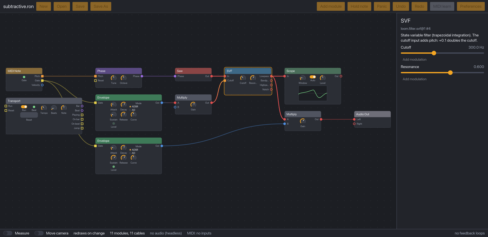
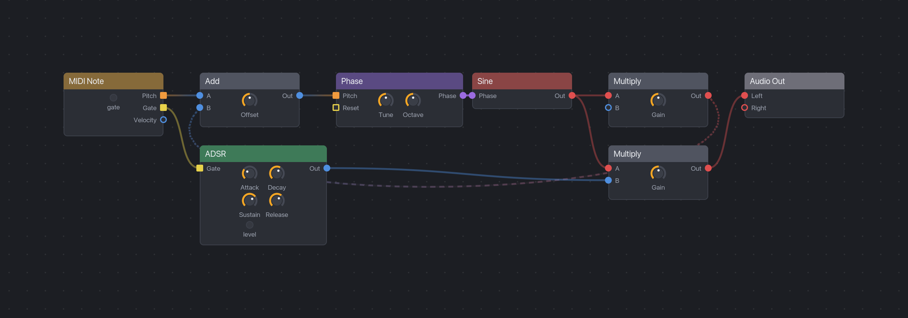

# LoomDSP

**A free, open-source modular synthesizer and sound lab. Patch it, play it live, share it.**

[](https://github.com/brylie/LoomDSP/actions/workflows/ci.yml)
[](https://codecov.io/gh/brylie/LoomDSP)
[](LICENSE)
[](docs/product/roadmap.md)
<!-- ALL-CONTRIBUTORS-BADGE:START - Do not remove or modify this section -->
[](#contributors-)
<!-- ALL-CONTRIBUTORS-BADGE:END -->



Build your own instruments and effects by connecting small modules with virtual cables: oscillators, filters, envelopes, logic, and more. Hear every change as you make it. Plug in a MIDI keyboard or controller and play what you built. Then send the patch file to a friend.

LoomDSP is free, with no accounts, no subscriptions, and no paid tiers. The whole thing is open source, so you can see how every module makes its sound, and nobody can take your instruments away.

## Who it is for

- **Musicians and performers** who want a patchable instrument they can change on stage without the sound cutting out.
- **Sound designers** who want deep control, from a single oscillator up to whole systems, and sounds that come out the same every time.
- **Modular synth fans** who like the Eurorack way of patching anything to anything, without the rack, the rails, or the price.
- **Curious beginners** who want to learn how synthesis works by building it, one cable at a time.

## What makes it different

- **Edit while it plays, with no dropouts.** Add, remove, and rewire modules during a performance. In a 10-minute stress test, 11,026 live edits caused zero dropouts ([benchmark](docs/benchmarks/p0-engine.md)).
- **Patch anything to anything.** Every cable carries the same kind of signal, as in Eurorack. Audio can modulate a filter, an envelope can drive pitch, and a gate can be audio. Colours guide you, but never block a connection.
- **Real feedback.** Patch an oscillator back into itself for feedback FM, or feed a filter into its own input. The engine handles it sample by sample, so it sounds right.
- **Same sound, every time.** A patch gives identical audio on every run and at any buffer size. Renders are repeatable.
- **Safe for your ears and speakers.** A limiter and a short fade-in sit before the output, so a wild patch never blasts you ([how it works](docs/learn/output-safety.md)).
- **Play it with real controllers.** Every connected MIDI keyboard works at once, and MIDI learn maps any knob to a control on your hardware.
- **Smooth and responsive.** The canvas is drawn on the GPU and stays at 120 fps with 300 modules on screen, on an M1 laptop ([benchmark](docs/benchmarks/p1-canvas.md)).
- **Learn as you patch.** Every module and control explains itself on hover, and the [explainers](docs/learn/README.md) cover the ideas behind them: phase, feedback, stereo cables, and more.
- **Yours to keep.** Apache-2.0 licence. Patches are plain text files that never run code, so sharing them is safe, and the patches you make are yours under any licence you choose.



## Where it is going

The goal is bigger than a synth. LoomDSP is for **living musical systems**: patches that play, evolve, and arrange themselves with sequencers, loopers, counters, and logic, all patched the same way. Read the [vision](docs/product/vision.md).

| Phase | What you get |
|---|---|
| **P0. Engine** (done) | A real-time engine that plays patch files with live MIDI. |
| **P1. Desktop patcher** (now) | Build and play a synth from primitives, with MIDI controllers. |
| P2. Panels and performance | Sub-patches with their own front panels, polyphony, presets, and a locked performance mode. |
| P3. Living systems | Loopers, sequencers, scenes, counters, and logic: patches that arrange themselves on stage. |
| P4. Sharing | Self-contained patch files, a patch library, and a module SDK for community modules. |

Plugin export (CLAP, VST3) and a browser version may come later. See the full [roadmap](docs/product/roadmap.md).

## What you can do today

LoomDSP is in **early alpha** (Phase 1 of the roadmap). It is not a finished instrument yet, but you can already:

- **Patch on a canvas.** Add modules from a searchable browser, or type to add one at the pointer. Drag cables, move tiles, copy, paste, and duplicate.
- **Turn knobs on the modules themselves.** Each tile has its own panel of knobs, buttons, and lights.
- **Modulate any parameter.** Assign any output to a knob, and watch the range arc and the live value move.
- **Play it.** Use a MIDI keyboard, or click **Hold note** if you have none.
- **Work without fear.** Undo and redo for every edit, open and save patches, and autosave with crash recovery.
- **Choose your audio device** and buffer size in the preferences window.
- **Render to WAV** from the command line.

Modules so far: phase generator, sine, band-limited saw, noise, state variable filter, ADSR, add, multiply, constant, one-sample delay, clock divider, phase trigger, level meter, button, MIDI note input, and audio output. Around 170 more are planned in the [module catalogue](docs/product/module-catalogue.md).

**Early alpha means breaking changes.** Until the architecture settles, module names and the patch format can change.

## Try it

### Download

Get the file for your computer from the [latest release](https://github.com/brylie/LoomDSP/releases/latest), extract it (unzip it, or unpack the `.tar.gz` on Linux), and open LoomDSP.

| System | File |
|---|---|
| macOS, Apple Silicon (M1 and newer) | `LoomDSP-...-macos-arm64.zip` |
| macOS, Intel | `LoomDSP-...-macos-x86_64.zip` |
| Windows | `LoomDSP-...-windows-x86_64.zip` |
| Linux | `LoomDSP-...-linux-x86_64.tar.gz` |

These early alpha builds are not signed yet, so macOS and Windows warn the first time. Each download has a `README.txt` with the steps:

- **macOS:** right-click `LoomDSP.app`, choose **Open**, then **Open** again.
- **Windows:** double-click `loom-app.exe`. On the "Windows protected your PC" screen, choose **More info**, then **Run anyway**.
- **Linux:** run `./loom-app` in a terminal.

Open `examples/patches/subtractive.ron` from the app. Connect a MIDI keyboard first, or click **Hold note** in the toolbar, then turn the filter's **Cutoff** knob while the note plays. [Getting started](docs/guide/getting-started.md) walks you through your first patch.

### Build it yourself

If there is no download for your system, or you want the newest changes, build LoomDSP on your own computer. It takes three steps and no coding.

1. **Install Rust**, the free tool that builds the app. Get it from [rustup.rs](https://rustup.rs) (version 1.99 or newer). On Linux, also install the ALSA development package (`libasound2-dev` on Debian and Ubuntu).
2. **Download LoomDSP.** Either run `git clone https://github.com/brylie/LoomDSP`, or press **Code**, then **Download ZIP**, at the top of this page and unzip it. This gives you a folder named `LoomDSP` (or `LoomDSP-main` from the ZIP).
3. **Build and open it.** In a terminal, go into that folder and run:

```sh
cd LoomDSP
cargo run --release -p loom-app -- examples/patches/subtractive.ron
```

If you used the ZIP, type `cd LoomDSP-main` instead.

The first build takes a few minutes. Later starts are instant.

**On a Mac and want an app icon you can double-click?** Run `scripts/bundle-macos.sh`. It prints the path to `LoomDSP.app`, which you can drag into your Applications folder. It is not signed, so it works on the Mac that built it.

More things to try:

```sh
# Feedback FM: an oscillator that modulates itself
cargo run --release -p loom-app -- examples/patches/fm-feedback.ron

# Start from an empty canvas
cargo run --release -p loom-app

# List every module
cargo run --release -p loom-cli -- modules

# Play a patch from the terminal with your MIDI keyboard, or hold one note
cargo run --release -p loom-cli -- play examples/patches/fm-feedback.ron --note 57

# Render a chord to a WAV file
cargo run --release -p loom-cli -- render examples/patches/subtractive.ron -o out.wav --note 48 --note 55 --note 60

# Show where the engine found feedback loops
cargo run --release -p loom-cli -- check examples/patches/fm-feedback.ron

# Rewire the patch 20 times a second while it plays, and count dropouts
cargo run --release -p loom-cli -- stress examples/patches/subtractive.ron --seconds 600
```

## Get involved

You do not need to write code to help.

- **Try it and tell us.** Patch something, then open an [issue](https://github.com/brylie/LoomDSP/issues) with what felt good and what got in the way.
- **Share a patch** or tell us which modules you want next.
- **Improve the docs and explainers.** If something confused you, it will confuse the next person too.
- **Write a module.** LoomDSP is built in Rust, and most [`good first issue`](https://github.com/brylie/LoomDSP/labels/good%20first%20issue) tasks are new modules, each with a spec and a test harness that checks it for you.

Read [CONTRIBUTING.md](CONTRIBUTING.md) to get started. AI-assisted contributions are welcome under our [AI contribution policy](AI_POLICY.md). During October, issues labelled [`hacktoberfest`](https://github.com/brylie/LoomDSP/labels/hacktoberfest) count for Hacktoberfest.

## Documentation

- [Getting started](docs/guide/getting-started.md): run the app and patch your first sound
- [Learn](docs/learn/README.md): the theory behind the design, for musicians and developers
- [Architecture](docs/dev/architecture.md): how the code fits together
- [Vision](docs/product/vision.md), [requirements](docs/product/requirements.md), [roadmap](docs/product/roadmap.md), and [module catalogue](docs/product/module-catalogue.md)
- [Architecture decisions](docs/adr/README.md) and [specifications](docs/design/README.md)
- Benchmarks: [Phase 0 engine](docs/benchmarks/p0-engine.md), [Phase 1 canvas](docs/benchmarks/p1-canvas.md)
- [Everything else](docs/README.md)

<details>
<summary>Repository layout</summary>

| Path | What it is |
|---|---|
| `crates/loom-core` | Engine core: module API, graph, compiler, real-time engine. No I/O, builds for WASM. |
| `crates/loom-modules` | Built-in modules, integration tests, and benchmarks. |
| `crates/loom-patch` | RON patch format: load and save. |
| `crates/loom-rt` | Small real-time helpers (denormal flushing, smoothing). Reusable outside LoomDSP. |
| `crates/loom-host-desktop` | Audio (cpal) and MIDI (midir) host for desktop. |
| `crates/loom-cli` | The `loom` command-line tool. |
| `crates/loom-canvas` | The patch canvas: a GPU-drawn Iced widget ([ADR-0010](docs/adr/0010-own-patch-canvas.md)). |
| `crates/loom-app` | The desktop app: canvas, inspector, live audio and MIDI. |
| `examples/patches` | Example patches. |
| `docs` | Guides, explainers, requirements, roadmap, ADRs, specifications, and benchmarks. |

</details>

## Licence

Apache-2.0. See [LICENSE](LICENSE). Patches you create are yours, under any licence you choose.

## Contributors ✨

Thanks goes to these wonderful people ([emoji key](https://allcontributors.org/docs/en/emoji-key)):

<!-- ALL-CONTRIBUTORS-LIST:START - Do not remove or modify this section -->
<!-- prettier-ignore-start -->
<!-- markdownlint-disable -->
<table>
  <tbody>
    <tr>
      <td align="center" valign="top" width="14.28%"><a href="https://github.com/brylie"><br /><sub><b>Brylie Oxley</b></sub></a><br /><a href="https://github.com/brylie/LoomDSP/commits?author=brylie" title="Code">💻</a></td>
      <td align="center" valign="top" width="14.28%"><a href="https://github.com/montionugera"><br /><sub><b>Pasit Nusso</b></sub></a><br /><a href="https://github.com/brylie/LoomDSP/commits?author=montionugera" title="Code">💻</a></td>
    </tr>
  </tbody>
</table>

<!-- markdownlint-restore -->
<!-- prettier-ignore-end -->

<!-- ALL-CONTRIBUTORS-LIST:END -->

This project follows the [all-contributors](https://github.com/all-contributors/all-contributors) specification. Contributions of any kind welcome!
