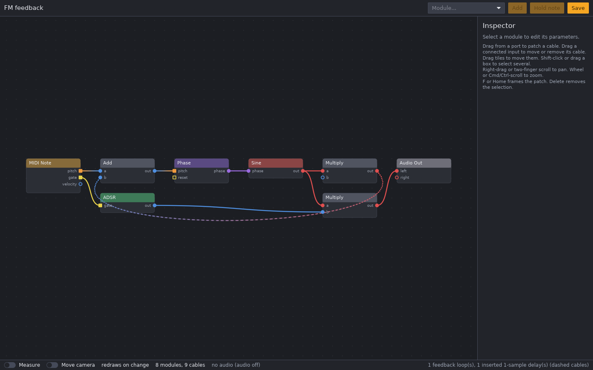
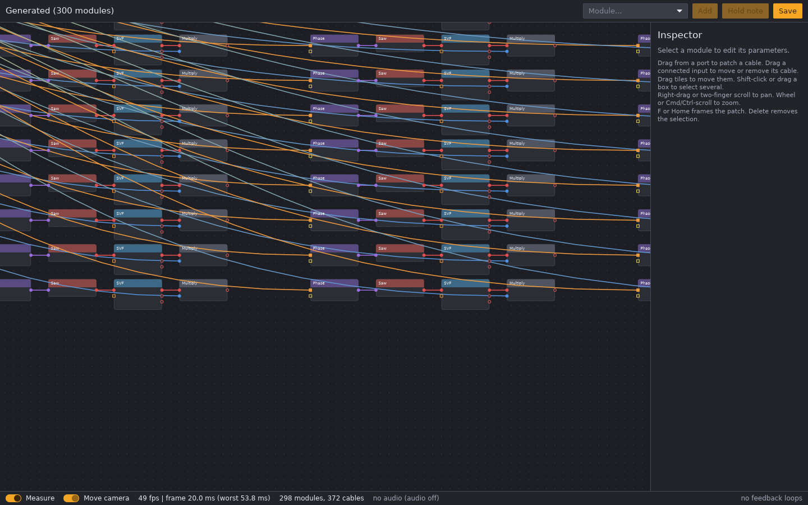

# P1 Canvas Prototype

The first version of our own patch canvas ([ADR-0010](../adr/0010-own-patch-canvas.md)): the `loom-canvas` crate (an Iced widget) and the `loom-app` desktop app. This page records how to measure it against the performance gates, and the results.



## What is in the prototype

- Compact module tiles on a 12-unit snap grid. Signal flows left to right. Inputs on the left edge, outputs on the right.
- Ports coloured by signal type, with shape as a second cue: pitch and gate are square, the others round. Connected ports are filled, free ports are rings.
- Cables as curves, coloured from source to destination type. Cables where the engine inserted a 1-sample delay are dashed. Feedback cables (running right to left) loop below the modules.
- Cables run behind the tiles at a fixed, dim opacity. The hovered cable, the cables on a hovered port, and the cables of selected or hovered modules come to the front at full brightness. The background level never changes, so moving the pointer does not make the whole patch flicker.
- Level of detail: titles only when at least 6.5 px tall, port labels only when at least 7.5 px tall.
- Inspector panel for the selected module, with logarithmic sliders for frequencies and times.
- Live audio and MIDI while editing. Every edit goes through the engine's lock-free schedule swap.
- A stats bar: frame rate, average and worst frame time, module and cable count, audio load and overruns.

Gestures: drag from a port to patch a cable; drag a connected input to move or remove its cable; drag tiles to move them; shift-click or drag a box to select; right-drag or two-finger scroll to pan; mouse wheel or Cmd/Ctrl-scroll to zoom; F or Home frames the patch; Delete removes the selection.

## How it draws

One custom wgpu primitive draws the whole canvas, in this order:

1. A dot grid: one quad with a few operations per pixel, faded out when zoomed far out.
2. Cables: one instanced triangle strip per cable, dimmed. The vertex shader builds the curve from the two end points, so a cable is 64 bytes of GPU data.
3. Tiles: instanced rounded rectangles. Each one shades only its own pixels.
4. Focused cables: the hovered cable, those on a hovered port, those of selected and hovered modules, and the one being dragged, at full opacity. Rebuilt each frame; usually only a handful.
5. Ports, then outlines for selection and hover, and the selection box.
6. Text, through Iced, on top.

Tile, port, and cable data is built on the CPU and uploaded only when the scene changes. Panning and zooming change one 32-byte uniform buffer. Without the **Measure** toggle, the window redraws only when visible state changes.

## How to measure (reference laptop)

```sh
cargo run --release -p loom-app -- --generate 300 --bench
```

`--bench` turns on **Measure** (redraw every frame and count) and **Move camera** (a slow loop of pan and zoom). `--measure` turns on only **Measure**, so the camera stays still. Run it at full window size on the built-in Retina display. To test the "100 visible" case, switch off **Move camera**, zoom in until about 100 tiles are on screen (titles visible), then switch it back on. The camera loops around the current view.

Both flags also print the numbers to stdout once a second, so a script or an agent can read them. `--bench-seconds N` exits after N seconds with a final line:

```sh
cargo run --release -p loom-app -- examples/patches/subtractive.ron --measure --bench-seconds 3
```

The output (MacBook, external 72 Hz display, 2026-10-20):

```text
fps=58.9 avg_ms=16.98 worst_ms=24.77 frames=59 scene_builds=1 control_builds=1 scene_uploads=1 control_uploads=1 overlay_uploads=0
fps=71.8 avg_ms=13.92 worst_ms=24.77 frames=131 scene_builds=1 control_builds=1 scene_uploads=1 control_uploads=1 overlay_uploads=0
final fps=71.9 avg_ms=13.91 worst_ms=24.77 frames=203 scene_builds=1 control_builds=1 scene_uploads=1 control_uploads=1 overlay_uploads=0
```

Each line is `key=value` pairs separated by spaces. The numbers come from the canvas itself (`loom_canvas::stats`), so they count frames really drawn:

- `fps` and `avg_ms`: frames in the last second, and the average time between them. On the final line, from the first line to the end, so start-up is left out.
- `worst_ms`: the longest gap between two frames since the start, after the first 10.
- `frames`, `scene_builds`, `control_builds`, `scene_uploads`, `control_uploads`, `overlay_uploads`, `trace_uploads`: totals since the start. A still or moving camera should build and upload the scene once. A knob turn adds control builds and uploads, never scene builds. A moving scope trace adds trace uploads only.

**Idle.** `--measure` and `--bench` redraw every frame, so they measure drawing cost. `--measure-idle` prints the same lines without forcing a redraw: it counts only the frames the app draws by itself. The report runs on its own thread and sends the app no messages, so it adds no frames. An idle patch prints `frames=0` after the first second (the panels spec, Redraw). Until [#90](https://github.com/brylie/LoomDSP/issues/90) it printed 4 to 7 frames a second, from the stats bar timer and the device polls:

Each line also prints `causes=tick:N,live:N,meters:N,control:N,input:N,redraw:N,forced:N,other:N` as totals since the report began. A frame can count under several causes. `cpu=N.N` is the whole process's user plus system CPU time during that line's interval, as a percentage of one core. The final line covers the full measured interval. See [frame meter](../design/frame-meter.md).

```sh
cargo run --release -p loom-app -- examples/patches/subtractive.ron --measure-idle --bench-seconds 10
```

For idle CPU, read Activity Monitor during the same run. Without an audio device, add `--fake-audio`: the engine then runs from a timer, so live values, lights, and meters move as with a device, and their redraws are counted too.

Record from the stats bar, or the final line, after about 10 seconds:

| Run | fps | frame avg | worst | Notes |
|---|---|---|---|---|
| `--generate 300 --bench`, whole patch in view (titles hidden) | 120 (display maximum) | about 8.3 ms | | Reference laptop, 2026-10-14 |
| Same, zoomed to about 100 tiles visible (titles shown) | | | | |
| Same, zoomed in to about 20 tiles (port labels shown) | | | | |
| `examples/patches/fm-feedback.ron`, **Measure** on, camera still | | | | |
| Idle: `--measure-idle`, nothing moving. Frames drawn, and Activity Monitor CPU % and GPU % | | | | |

Pass criteria (NFR-PERF-04): 60 fps with 300 modules in the patch and 100 visible, while panning and zooming. An idle patch uses close to no CPU or GPU. The 4 live scopes come with module views (next P1 step) and are measured then.

## First results

### Cloud VM, software rendering (2026-10-13)

A 2-vCPU cloud VM with no GPU, rendering through Mesa's software Vulkan driver (lavapipe) at 1440 x 900. This says nothing about real GPU performance, but it is the same machine and driver the P0 spikes were measured on, so the two can be compared.

| Run | P0 spike (iced_nodegraph) | P1 canvas |
|---|---|---|
| 300 modules, whole patch in view, camera moving | 2 to 7 fps | 42 fps |
| 300 modules, zoomed in with titles, camera moving | | 49 fps (20 ms average) |
| 300 modules, zoomed in with titles, camera still | | 53 fps |

On software rendering every pixel costs CPU time, so this is a rough sign that the per-pixel cost has dropped by about an order of magnitude.



### Reference laptop (M1 family, built-in Retina)

**First result (2026-10-14):** a steady 120 fps with `examples/patches/fm-feedback.ron` (8 modules) while moving the canvas by hand. 120 fps is the display's refresh rate (ProMotion), so each frame finishes early and waits for the screen. The P0 spike reached 40 fps with the same 8-module patch.

**300 modules (2026-10-14):** an average of 120 fps with `--generate 300 --bench` and the camera moving, the display's maximum. The P0 spike reached 22 to 24 fps in the same test.

Still to record: the zoomed-in runs (titles and port labels drawn) and idle CPU and GPU (table above).
