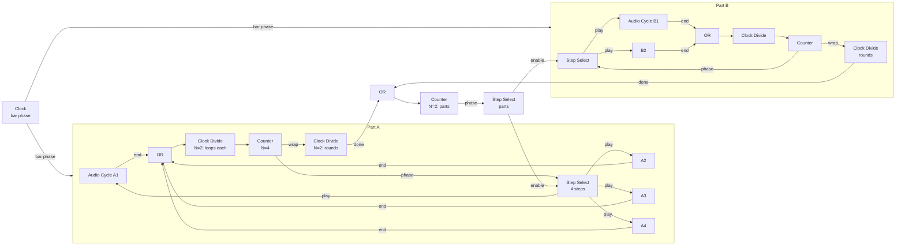

# Arrangement Specification

How LoomDSP builds arrangements inside the grid: loops that rotate, parts that follow each other, and songs that play themselves, all from ordinary modules.

- **Kind:** living specification. It changes as modules are built and tested.
- **Decision behind it:** [ADR-0012](../adr/0012-arrangement-from-phase-driven-primitives.md) (arrangement from phase-driven primitives). Builds on [ADR-0007](../adr/0007-polymorphic-signal-model.md) (signals) and [ADR-0011](../adr/0011-everything-is-a-module.md) (everything is a module).
- **Use case:** [UC8](../product/personas-and-use-cases.md) (Ilmari, the generative musician).
- **Requirements:** FR-LIB-16, FR-LIB-19 to FR-LIB-22, FR-LIB-24.
- **Issues:** [#47](https://github.com/brylie/LoomDSP/issues/47) to [#55](https://github.com/brylie/LoomDSP/issues/55), and [#39](https://github.com/brylie/LoomDSP/issues/39).

## The goal

> Play the loops of group A round robin, each loop twice. When group A has done this twice, play group B the same way. Then return to A, or go somewhere else.

A fixed clip launcher cannot express this. In LoomDSP it is ordinary patching, and any other rule can be patched the same way: a random part, part B only every third time, a MIDI pad that forces the next part.

## Primitives

All primitives follow the signal model: timing is **phase**, events are **gates** and **triggers** (what a trigger output sends is open: OQ-19, [#47](https://github.com/brylie/LoomDSP/issues/47)).

| Module | Inputs | Outputs | Behaviour |
|---|---|---|---|
| **Note Cycle** | bar phase, play (gate) | pitch, gate, velocity, end (trigger) | Plays a stored note pattern that is *length* bars long. Mono first; polyphony follows OQ-16. |
| **Audio Cycle** | bar phase, play (gate) | left, right, end (trigger) | Plays a stored audio loop that is *length* bars long. Fades over a few milliseconds when play changes, to avoid clicks. Recording follows OQ-15. |
| **Clock Divide** | trigger, reset | trigger | Fires on every Nth incoming trigger. "Loop twice, then move on." |
| **Counter** | trigger, reset | phase, wrap (trigger) | Counts triggers from 0 to N-1. The phase output is count ÷ N, so any phase-reading module can follow it. Wrap fires when the count returns to 0. |
| **Step Select** | phase, enable (gate) | N gates | Exactly one output is high: the step that the phase points at (step = floor(phase × N)). All outputs are low while enable is low. Enable counts as high when not connected. |

Logic modules (OR, AND, compare, probability) come from FR-LIB-05 and FR-LIB-22.

## Rules

Each rule has a reason, so later changes can be judged against it.

1. **Cycles read the clock's bar phase, not their own clock.** Length in bars is a parameter. *Why:* every cycle follows the same clock, so loops stay in sync, change tempo together, and never drift.
2. **Restart or join.** A cycle counts bar wraps internally to know where it is in its loop. In *restart* mode (the default), it starts from its beginning when play goes high. In *join* mode, it keeps counting while stopped and enters in step with the global position. *Why:* rotation needs each loop to start from its beginning; layered loops need to stay aligned with each other.
3. **End fires only while playing.** *Why:* the end outputs of a whole group can then be combined with one OR, and only the playing cycle advances the count.
4. **Switches happen on loop boundaries.** Patched logic is driven by end triggers, which come at loop ends, so no separate quantise step is needed. Manual triggers (a pad, a button) go through a clock quantiser first (FR-LIB-16). *Why:* musical changes land on the beat by construction.
5. **Location does not matter.** Play inputs are ordinary gates. *Why:* loopers can sit anywhere on the canvas, or inside different sub-patches, and still rotate.
6. **A part restarts from its first loop.** When a part's enable rises, its counter resets. *Why:* a part should sound the same each time it comes back.

## Worked example

Part A has four audio cycles, plays each loop twice, and is done after two rounds. Part B is set up the same way. A song level alternates between them.

The song level uses the same two primitives as the part level: a counter driving a step select. Arrangement is a step sequencer of step sequencers.

The automated version of this example is the P3 exit test ([#55](https://github.com/brylie/LoomDSP/issues/55)).

## Built-in abstractions

Working with only primitives is powerful but slow, as Pure Data shows. LoomDSP keeps three layers, all made of the same stuff:

1. **Primitives:** the modules above, plus logic. For people who want their own rules.
2. **Built-in abstractions,** shipped as patches made from primitives (FR-LIB-24). They work as one module, show a small view of what is playing, and open up to learn from or change.
3. **Panels** on top, for performance (FR-PANEL-*).

| Abstraction | Made from | Ports |
|---|---|---|
| **Looper Group** | N cycles, an OR of their ends, Clock Divide (loops per cycle), Counter, Step Select | bar phase, enable, reset; round done (trigger); mixed audio or notes |
| **Part** | A Looper Group plus a rounds counter | bar phase, start; done (trigger) |
| **Song Sequencer** | Counter and Step Select over parts | done triggers in; enable gates out |

Rule options for Looper Group: round robin, random, or chosen by an input. Users' own saved abstractions use the same format, which is how the shared library grows (FR-SHARE-*).

## Dependencies

| Needs | Why | Where |
|---|---|---|
| Module data (FR-LIB-19, OQ-17) | Cycles store patterns and audio. | [#50](https://github.com/brylie/LoomDSP/issues/50), P2 |
| Sub-patches (FR-ENCAP-*) | Without them the example is about 30 tiles; with them each part is one tile. | [#51](https://github.com/brylie/LoomDSP/issues/51), P2 |
| Trigger convention (OQ-19) | Counters and dividers count triggers. | [#47](https://github.com/brylie/LoomDSP/issues/47), P1 |
| Clock and transport (FR-LIB-16, [clock specification](clock.md)) | Cycles read the bar phase. Their bar phase input follows the transport by default. | [#41](https://github.com/brylie/LoomDSP/issues/41) |

## Performance note

End → counter → select → play is a cycle in the graph. The compiler inserts a one-sample delay and runs the loop one sample at a time (ADR-0002). The logic modules are cheap, but an Audio Cycle inside such a loop also runs per sample. Measure this with the P3 exit test, and consider giving end outputs a one-block delay if it costs too much.

## Open points

- What a trigger output sends (OQ-19).
- Whether Step Select needs more than 8 outputs, or whether larger selections should chain.
- Whether Looper Group's "random" rule avoids repeating the same loop twice in a row.
- How a cycle's view shows its play position and which loop of a group is next.
