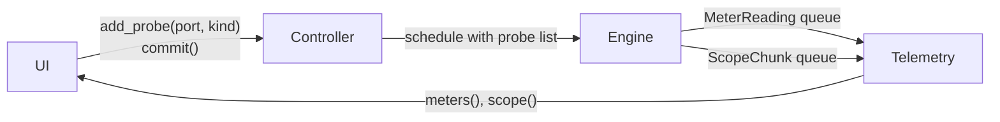

# Telemetry Specification

How meter and scope data travels from the audio thread to the UI.

- **Kind:** living specification. It changes as the views that use it are built.
- **Decision behind it:** [ADR-0001](../adr/0001-lock-free-control-audio-boundary.md) (lock-free boundary between control and audio threads).
- **Requirements:** FR-VIS-04, NFR-RT-01, NFR-RT-07. In the app: FR-VIS-01 (signal activity on ports and cables) and FR-VIS-02 (scope on any cable).
- **Issues:** [#6](https://github.com/brylie/LoomDSP/issues/6) (engine path), [#10](https://github.com/brylie/LoomDSP/issues/10) (cable activity), [#8](https://github.com/brylie/LoomDSP/issues/8) (scope probe).
- **Code:** engine side in `crates/loom-core/src/telemetry.rs`, `Engine::send_telemetry` in `engine.rs`, and probes in `compile.rs`. App side in `crates/loom-app/src/live.rs`, with drawing in `crates/loom-canvas` (`PortLevels`, the level buffer in `gpu.rs`, and `scope.rs`).

## How it works

1. **Probe.** The UI calls `Controller::add_probe(output, kind)` and gets a `ProbeId`. The kind is `Meter`, `Scope`, or `MeterAndScope`.
2. **Compile.** The next `Controller::commit` compiles the probe list into the schedule. Each probe becomes a pointer to the output port's buffer.
3. **Measure.** After each internal block (at most `max_block` frames), the engine reads every probed buffer. For a meter it pushes one `MeterReading` with the peak and RMS of the block. For a scope it copies the samples into `ScopeChunk`s of 64 samples (`SCOPE_CHUNK`) and pushes them.
4. **Read.** The control thread drains the queues through the `Telemetry` handle that `create_engine` returns. `meters()` and `scope()` take every waiting message, oldest first.

Every message carries the probe ID and an engine frame number (frames since the engine started). A gap between two scope chunks of the same probe means chunks were dropped.

## Rules

1. **The audio thread never waits for the UI.** Both queues are bounded `rtrb` queues of fixed-size `Copy` messages, allocated when the engine is created. *Why:* NFR-RT-01. A push into a full queue fails at once instead of blocking.
2. **Full queue: drop the newest telemetry.** The engine counts drops in `EngineStats::dropped_meters` and `EngineStats::dropped_scope`. *Why:* NFR-RT-07. Visual data can be lost safely. Edits travel on a different queue and are never dropped.
3. **Meters and scopes have separate queues.** *Why:* scopes send about 750 chunks per second per probe at 48 kHz. If they shared a queue with meters, a busy scope could starve every meter.
4. **Probes take effect at commit, like structural edits.** *Why:* a probe needs a pointer into the schedule's buffers, and only the compiler knows them. Recompiling is cheap, and module state survives the swap.
5. **Probes are view state.** They live in the `Controller`, not in the `Graph`, and are not saved in patches. Removing a module removes its probes. *Why:* what the UI is looking at is not part of the sound.
6. **Probes never change the sound.** The engine only reads the buffers after the block has run. *Why:* opening a scope must not change what the user hears (NFR-SND-02). A test checks that output with probes is bit-identical to output without.
7. **Telemetry is per internal block.** A host buffer of 1024 frames with `max_block` 128 gives eight meter readings per probe. *Why:* the block is the smallest unit the engine runs, so readings arrive at a steady rate whatever the host buffer size.

## Why queues and not triple buffers for scopes

ADR-0001 suggests triple buffering for large telemetry. A triple buffer shows only the latest snapshot. A scope needs every sample in order, so it can find a trigger point and draw a stable wave, and so the UI can see when samples were lost. A queue of fixed-size chunks does both. Triple buffering stays the better fit for data where only the latest value matters, such as a spectrum (FR-VIS-03).

## Sizes

| Setting | Default | Holds |
|---|---|---|
| `EngineConfig::meter_capacity` | 1024 readings | About 2.7 s of one meter at 48 kHz with 128-frame blocks |
| `EngineConfig::scope_capacity` | 1024 chunks | About 1.4 s of one scope at 48 kHz, about 280 KB |

Drain the queues once per UI frame. At 60 frames per second, one scope fills about 13 chunks per frame, so the defaults leave plenty of room for several probes.

## In the desktop app

`crates/loom-app/src/live.rs` keeps the probes in step with the graph and turns telemetry into things to draw.

### Probes

- **Signal activity** (FR-VIS-01). While the **Activity** toggle in the stats bar is on (the default), every output that has at least one cable gets a `Meter` probe. One probe per output, however many cables leave it.
- **Scopes** (FR-VIS-02). Clicking a cable, an output port, or a connected input opens a scope on the output that feeds it, with a `Scope` probe. At most four scopes are open. Opening a fifth closes the oldest. The **x** button on a scope closes it.
- **When.** `Live::sync` runs just before every `Controller::commit`, so new cables get meters and probes of removed modules are forgotten in the same commit.

The canvas reports the click as `CanvasEvent::Probe(port)`. A press and release within 3 screen pixels is a click. A connected input now keeps its cable until the pointer moves, so clicking it probes the cable instead of unplugging it.

### Once per frame

The app drains both queues in `Live::drain` on every frame message, or every tick when nothing moves.

1. **Meters.** For each probe, take the highest peak since the last frame. Map it to a level from 0 to 1: -60 dB and below is 0, 0 dB (1.0, or 10 V) and above is 1. The level rises at once and falls by 1.0 per second, so short notes stay visible.
2. **Scopes.** Append each chunk to the scope's history (one second of samples). If the chunk's frame stamp shows a gap, the history is cleared first. *Why:* drawing across lost samples would show a step that is not in the signal.
3. **Trigger.** Find the latest rising edge that still has a full window of samples after it (`find_trigger`). The trigger level is halfway between the lowest and highest sample in the history, so signals with an offset, such as envelopes and pitch, trigger too. An edge counts only if the signal was below the level by a tenth of its swing before it, so noise on a slow edge cannot trigger twice. The crossing is found to a fraction of a sample, and the scope shifts the trace by that fraction. *Why:* a period is rarely a whole number of samples. Without the fraction, the wave would jitter by up to one sample each frame. With no edge (a flat signal), the scope shows the latest samples and says **free**.
4. **Range.** The vertical range is the smallest of 0.01, 0.02, 0.05, ... 10 that fits the trace. It grows at once and shrinks only when the trace uses less than 40% of it, so it does not flicker.

The time window is 5, 20, 100, or 500 ms. The button on each scope steps through them.

### Drawing (ADR-0010)

- **Cable glow.** Cable instances stay on the GPU until the scene changes. Levels go in a second instance buffer with one float per cable, uploaded every frame. The cable shader makes a cable with signal brighter, a little wider, and gives it a soft glow. A cable that is not in focus becomes less dim as its level rises. *Why:* the level changes every frame, and rebuilding all cables every frame is what ADR-0010 rules out.
- **Port halos.** Each output port with a level above zero gets a ring in its signal colour, in the per-frame overlay. Outputs with an open scope get a ring in the selection colour.
- **Scopes.** The scopes sit in a strip below the canvas. `loom_canvas::Scope` draws one thin quad per pixel column, from the lowest to the highest value of the trace in that column. Each column includes the trace value at both of its edges, so the columns touch and read as a line. The cost is one quad per column, whatever the number of samples.

`PortLevels` lives outside `Scene` for the same reason as the level buffer: a new scene generation rebuilds all GPU data.

### Redraws

| State | Redraws |
|---|---|
| A scope is open, or a level is changing | Every frame |
| Probes, but every level is still (silence or a steady signal) | Every 100 ms, so new activity shows quickly |
| No probes, or no audio device | Every 500 ms, as before |

### Queue sizes in the app

The app sets `meter_capacity` to 16384 and `scope_capacity` to 4096. *Why:* activity meters every connected output. With 300 outputs at 48 kHz and 128-frame blocks, that is about 1900 readings per 60 fps frame, more than the default 1024. The stats bar shows **telemetry dropped N** if anything is lost.

## Tests

- `crates/loom-modules/tests/engine.rs`: the scope reproduces the probed signal sample for sample, meters match each block, probes inside feedback loops see every sample, full queues drop telemetry but not audio, and removed probes stop sending.
- `crates/loom-modules/tests/no_alloc.rs`: every output probed while the graph is edited, with queues both drained and full.
- `crates/loom-app/src/live.rs`: telemetry from a running engine reaches levels and a triggered scope; probes follow removed modules and the activity toggle; the oldest scope closes at the limit; the trigger finds rising edges, stays on the same phase from frame to frame with a period that is not a whole number of samples, works with an offset, and ignores noise on the edge; gaps clear the history.
- `crates/loom-canvas`: scope columns keep every peak and always touch; click targets for ports and cables; overlay levels match the overlay cables.

## Open points

- Probes on one port are independent. Two views of the same port send the data twice. Today a scoped output also has an activity meter, which is cheap, but a future meter view on the same port would duplicate it.
- Activity meters every connected output. The engine cost is one pass over each probed buffer per block. It has not been measured on a 300-module patch yet. If it matters, meter only outputs on screen.
- Scopes are docked below the canvas. Module views inside tiles (FR-LIB-17, FR-LIB-18) are the next step, and could show the same trace in place.
- ADR-0010 gate 2 (60 fps with four live scopes on the reference laptop) is not measured yet. See [p1-canvas.md](../benchmarks/p1-canvas.md).
- The trigger is a rising edge at the middle of the signal. There is no trigger level control, no falling edge, and no trigger from another signal yet.
