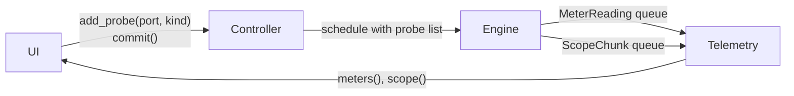

# Telemetry Specification

How meter and scope data travels from the audio thread to the UI.

- **Kind:** living specification. It changes as the views that use it are built.
- **Decision behind it:** [ADR-0001](../adr/0001-lock-free-control-audio-boundary.md) (lock-free boundary between control and audio threads).
- **Requirements:** FR-VIS-04, NFR-RT-01, NFR-RT-07. It serves FR-VIS-01 (live values on ports) and FR-VIS-02 (scope on any cable).
- **Issue:** [#6](https://github.com/brylie/LoomDSP/issues/6).
- **Code:** `crates/loom-core/src/telemetry.rs`, `Engine::send_telemetry` in `engine.rs`, probes in `compile.rs`.

## How it works

1. **Probe.** The UI calls `Controller::add_probe(output, kind)` and gets a `ProbeId`. The kind is `Meter`, `Scope`, or `MeterAndScope`.
2. **Compile.** The next `Controller::commit` compiles the probe list into the schedule. Each probe becomes a pointer to the output port's buffer.
3. **Measure.** After each internal block (at most `max_block` frames), the engine reads every probed buffer. For a meter it pushes one `MeterReading` with the peak and RMS of the block. For a scope it copies the samples into `ScopeChunk`s of 64 samples (`SCOPE_CHUNK`) and pushes them.
4. **Read.** The control thread drains the queues through the `Telemetry` handle that `create_engine` returns. `meters()` and `scope()` take every waiting message, oldest first.

Every message carries the probe ID and an engine frame number (frames since the engine started). A gap between two scope chunks of the same probe means chunks were dropped.

## Rules

1. **The audio thread never waits for the UI.** Both queues are bounded `rtrb` queues of fixed-size `Copy` messages, allocated when the engine is created. *Why:* NFR-RT-01. A push into a full queue fails at once instead of blocking.
2. **Full queue: drop the newest telemetry.** The engine counts drops in `EngineStats::dropped_meters` and `EngineStats::dropped_scope`. *Why:* NFR-RT-07. Visual data can be lost safely. Edits travel on a different queue and are never dropped.
3. **Meters and scopes have separate queues.** *Why:* scopes send about 750 chunks per second per probe at 48 kHz. If they shared a queue with meters, a busy scope could starve every meter.
4. **Probes take effect at commit, like structural edits.** *Why:* a probe needs a pointer into the schedule's buffers, and only the compiler knows them. Recompiling is cheap, and module state survives the swap.
5. **Probes are view state.** They live in the `Controller`, not in the `Graph`, and are not saved in patches. Removing a module removes its probes. *Why:* what the UI is looking at is not part of the sound.
6. **Probes never change the sound.** The engine only reads the buffers after the block has run. *Why:* opening a scope must not change what the user hears (NFR-SND-02). A test checks that output with probes is bit-identical to output without.
7. **Telemetry is per internal block.** A host buffer of 1024 frames with `max_block` 128 gives eight meter readings per probe. *Why:* the block is the smallest unit the engine runs, so readings arrive at a steady rate whatever the host buffer size.

## Why queues and not triple buffers for scopes

ADR-0001 suggests triple buffering for large telemetry. A triple buffer shows only the latest snapshot. A scope needs every sample in order, so it can find a trigger point and draw a stable wave, and so the UI can see when samples were lost. A queue of fixed-size chunks does both. Triple buffering stays the better fit for data where only the latest value matters, such as a spectrum (FR-VIS-03).

## Sizes

| Setting | Default | Holds |
|---|---|---|
| `EngineConfig::meter_capacity` | 1024 readings | About 2.7 s of one meter at 48 kHz with 128-frame blocks |
| `EngineConfig::scope_capacity` | 1024 chunks | About 1.4 s of one scope at 48 kHz, about 280 KB |

Drain the queues once per UI frame. At 60 frames per second, one scope fills about 13 chunks per frame, so the defaults leave plenty of room for several probes.

## Tests

- `crates/loom-modules/tests/engine.rs`: the scope reproduces the probed signal sample for sample, meters match each block, probes inside feedback loops see every sample, full queues drop telemetry but not audio, and removed probes stop sending.
- `crates/loom-modules/tests/no_alloc.rs`: every output probed while the graph is edited, with queues both drained and full.

## Open points

- The app does not draw meters or scopes yet. They will be displays on module panels: a scope module and port activity ([panels specification](panels.md)).
- Module display values (a sequencer's current step, an envelope's stage) need a path of their own, beside port probes. See the panels specification.
- Probes on one port are independent. Two views of the same port send the data twice.
