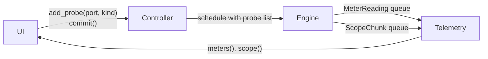

# Telemetry Specification

How meter and scope data travels from the audio thread to the UI.

- **Kind:** living specification. It changes as the views that use it are built.
- **Decision behind it:** [ADR-0001](../adr/0001-lock-free-control-audio-boundary.md) (lock-free boundary between control and audio threads).
- **Requirements:** FR-VIS-04, NFR-RT-01, NFR-RT-07. It serves FR-VIS-01 (live values on ports) and FR-VIS-02 (scope on any cable).
- **Issue:** [#6](https://github.com/brylie/LoomDSP/issues/6).
- **Code:** `crates/loom-core/src/telemetry.rs`, `Engine::send_telemetry` in `engine.rs`, probes in `compile.rs`. App side: `crates/loom-app/src/live.rs`.

## How it works

1. **Probe.** The UI calls `Controller::add_probe(output, kind)` and gets a `ProbeId`. The kind is `Meter`, `Scope`, or `MeterAndScope`.
2. **Compile.** The next `Controller::commit` compiles the probe list into the schedule. Each probe becomes a pointer to the output port's buffer.
3. **Measure.** After each internal block (at most `max_block` frames), the engine reads every probed buffer. For a meter it pushes one `MeterReading` with the peak and RMS of the block. For a scope it copies the samples into `ScopeChunk`s of 64 samples (`SCOPE_CHUNK`) and pushes them.
4. **Read.** The control thread drains the queues through the `Telemetry` handle that `create_engine` returns. `meters()` and `scope()` take every waiting message, oldest first.

Every message carries the probe ID and an engine frame number (frames since the engine started). A gap between two scope chunks of the same probe means chunks were dropped.

## Rules

1. **The audio thread never waits for the UI.** Both queues are bounded `rtrb` queues of fixed-size `Copy` messages, allocated when the engine is created. *Why:* NFR-RT-01. A push into a full queue fails at once instead of blocking.
2. **Full queue: drop the newest telemetry.** The engine counts drops in `EngineStats::dropped_meters` and `EngineStats::dropped_scope`. *Why:* NFR-RT-07. Visual data can be lost safely. Edits travel on a different queue and are never dropped.
3. **Meters and scopes have separate queues.** *Why:* scopes send about 750 chunks per second per probe at 48 kHz. If they shared a queue with meters, a busy scope could starve every meter.
4. **Probes take effect at commit, like structural edits.** *Why:* a probe needs a pointer into the schedule's buffers, and only the compiler knows them. Recompiling is cheap, and module state survives the swap.
5. **Probes are view state.** They live in the `Controller`, not in the `Graph`, and are not saved in patches. Removing a module removes its probes. *Why:* what the UI is looking at is not part of the sound.
6. **Probes never change the sound.** The engine only reads the buffers after the block has run. *Why:* opening a scope must not change what the user hears (NFR-SND-02). A test checks that output with probes is bit-identical to output without.
7. **Telemetry is per internal block.** A host buffer of 1024 frames with `max_block` 128 gives eight meter readings per probe. *Why:* the block is the smallest unit the engine runs, so readings arrive at a steady rate whatever the host buffer size.

## Why queues and not triple buffers for scopes

ADR-0001 suggests triple buffering for large telemetry. A triple buffer shows only the latest snapshot. A scope needs every sample in order, so it can find a trigger point and draw a stable wave, and so the UI can see when samples were lost. A queue of fixed-size chunks does both. Triple buffering stays the better fit for data where only the latest value matters, such as a spectrum (FR-VIS-03).

## Sizes

| Setting | Default | Holds |
|---|---|---|
| `EngineConfig::meter_capacity` | 1024 readings | About 2.7 s of one meter at 48 kHz with 128-frame blocks |
| `EngineConfig::scope_capacity` | 1024 chunks | About 1.4 s of one scope at 48 kHz, about 280 KB |

Drain the queues once per UI frame. At 60 frames per second, one scope fills about 13 chunks per frame, so the defaults leave plenty of room for several probes.

## In the desktop app

The app hands the `Telemetry` handle from `create_engine` to a telemetry thread (`crates/loom-app/src/monitor.rs`). The thread drains both queues every 33 ms, so they never fill, and sends the UI a message only when a meter level visibly changes. *Why a thread:* in Iced every message redraws the window, so draining on a UI timer would draw frames even when every meter is silent. `crates/loom-app/src/live.rs` holds the parts:

- **`Live::sync`** runs before every `Controller::commit` and whenever the meters on screen change. It keeps a `Meter` probe on the output of every meter widget on screen ([panels](panels.md#level-meters-and-audio-load-p1)), and forgets probes of removed modules. With signal activity on, every output with a cable gets one too; activity is off.
- **`Levels`**, on the telemetry thread, turns readings into levels from 0 to 1: -60 dB and below is 0, 0 dB (1.0, or 10 V) and above is 1. The peak is the highest since the last drain. The RMS is taken over every frame since the last drain, weighted by block length, because a block can be shorter than one cycle of the signal. Both rise at once and fall by 1.0 per second, using the time since the last drain, so the drain rate does not change them. The peak is never below the RMS.
- **`ScopeTrace`** turns the chunks of one scope probe into a stable trace:
  1. It keeps one second of samples. If the frame stamps show a gap, it clears the history first. *Why:* drawing across lost samples would show a step that is not in the signal.
  2. It finds the latest rising edge that still has a full window after it. The trigger level is halfway between the lowest and highest sample in the history, so signals with an offset, such as envelopes and pitch, trigger too. An edge counts only if the signal was below the level by a tenth of its swing before it, so noise on a slow edge cannot trigger twice. A flat signal falls back to the latest samples ("free run").
  3. It finds the crossing to a fraction of a sample (`offset`). *Why:* a period is rarely a whole number of samples. Drawing shifted by the fraction keeps the wave still instead of jittering by up to one sample per frame.
  4. It picks a vertical range from 0.01, 0.02, 0.05, ... 10. The range grows at once and shrinks only when the trace uses less than 40% of it, so it does not flicker.

The planned direction for displays: signal displays are modules in the grid, not views laid over the canvas (ADR-0011, everything is a module). A scope module saves with the patch, sits next to the signal it shows, travels inside sub-patches, and can go on a front panel. It animates only while its tile is visible and large enough to read.

## Tests

- `crates/loom-modules/tests/engine.rs`: the scope reproduces the probed signal sample for sample, meters match each block, probes inside feedback loops see every sample, full queues drop telemetry but not audio, and removed probes stop sending.
- `crates/loom-modules/tests/no_alloc.rs`: every output probed while the graph is edited, with queues both drained and full.
- `crates/loom-app/src/live.rs`: no probes until something asks; meters on screen get probes and lose them off screen; RMS over every frame since the last drain; silent probes are forgotten; telemetry from a running engine reaches meter levels and a triggered trace; probes follow removed modules and the activity switch. Trigger: rising edges, the same phase across frames with a period that is not a whole number of samples, signals with an offset, noise on the edge, flat signals. Gaps clear the history. Range steps.

## Open points

- The app draws meters (the level meter module and meter widgets) but not scopes yet (FR-VIS-02). Planned, in the [panels specification](panels.md): a scope module that reads its probe through these queues, drawn by the canvas inside its tile, and an activity display without constant motion (FR-VIS-01). Meters must not brighten cables: pulsing cables are tiring and hide the hover focus in large patches.
- Probes on one port are independent. Two views of the same port send the data twice.
