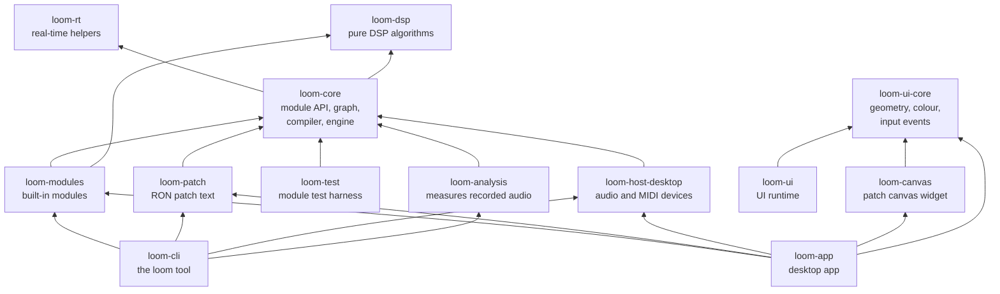
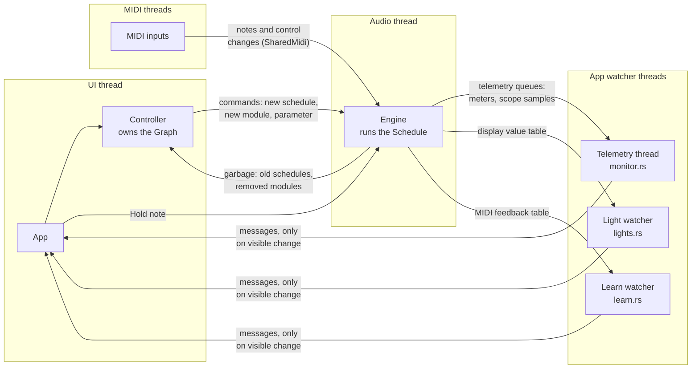

# Architecture

How LoomDSP's code fits together, for people who want to change it. Read [AGENTS.md](../../AGENTS.md) for the hard rules and [CONTRIBUTING.md](../../CONTRIBUTING.md) for the build and review process. The reasons behind each design are in the [ADRs](../adr/README.md).

## Crates



| Crate | Job | Rules |
|---|---|---|
| `loom-rt` | Small real-time helpers: denormal flushing, parameter smoothing. | No dependencies on the rest. |
| `loom-dsp` | Pure DSP algorithms with no ports or graph (ADR-0035, [spec](../design/dsp-algorithms.md)). Modules wrap them. | No dependency that reaches users, no `unsafe`, and no allocation after `new`, each enforced by a check. Same real-time rules as `loom-core`. |
| `loom-core` | The `Module` trait, the editable `Graph`, the compiler, the `Engine` that runs on the audio thread, and the `Controller` that edits it. | Portable: builds for WebAssembly. No threads, files, or audio APIs. |
| `loom-modules` | Every built-in module, plus integration tests and benchmarks. The `test-modules` feature adds `test_modules`, modules with IDs under `test.` for tests and `loom-app --test-modules`. | Same as `loom-core`. |
| `loom-patch` | Turns patches into RON text and back, migrates them, flattens sub-patch definitions into the flat graph (`flatten.rs`, [sub-patches](../design/sub-patches.md)), applies them to a `Controller`, and keeps the editor's sub-patch hierarchy beside the flat graph (`hierarchy.rs`, ADR-0039): paths, ports, instances, boundary cables, and the inverse of flattening that saves a nested file. Library items and linked sub-patches are in `library.rs`: a patch file becomes a definition and back, linked copies are refreshed when a patch loads, read through the `Library` trait the caller implements. It opens no files; the app reads and saves them, and reads the library folder for it (`patch_file.rs`). Slots (`slot.rs`, `hierarchy/slots.rs`, [sub-patches](../design/sub-patches.md#slots)): a slot module's part is an ordinary module of its level that the editor hides; the flattener routes the slot's role ports and parameters to the part, and a swap adds the new part and one hidden swap fade per role output, wired by `sync`, until the app finishes the fade. Roles themselves are data in `loom-core` (`role.rs`), declared on module descriptors and checked by the registry. Modes (`modes.rs`, `hierarchy/modes.rs`, ADR-0040): the flattener runs a stack's inside once per copy and adds hidden modules for a mode (a Sum or Stereo spread sum per output, a Member module and a Select per output for a select, a constant for a spread's hidden assignments); copies past the first and those modules are implied, on paths with a reserved step, and `sync` rebuilds them from the flattener, so the editor shows and edits copy 0 alone. A mapping on copy 0 carries the other copies as MIDI followers (`Controller::set_midi_followers`). | Same as `loom-core`. |
| `loom-test` | The module test harness: renders one module, checks block-size invariance, and compares with reference WAV files. | Desktop only, for tests. Only `dev-dependencies` use it, so it never ships. |
| `loom-analysis` | Measures recorded audio: peak, clipping, the largest step, and DC. `loom analyze` and the app's audio QA tests use the same functions ([audio QA](../design/audio-qa.md)). | Desktop only: it reads WAV files. |
| `loom-host-desktop` | Connects the engine to audio devices (cpal) and MIDI inputs (midir). For development, can also play it from a timer with no device, play it only when a test steps a tape (`AudioOutput::stepped`), and record it to a WAV file across many streams (`Recorder`). | Desktop only. The only crate that knows about audio APIs. |
| `loom-ui-core` | Plain types for the UI layer ([UI layer](../design/ui-layer.md), ADR-0041): geometry and colour (`Point`, `Vector`, `Size`, `Rect`, `Color`) and input events (`Event`, `PointerEvent`, `KeyEvent`, `Key`, `Modifiers`, `ScrollDelta`). UI IDs join it in a later step of [the plan](leaving-iced-plan.md). | No dependencies at all: no UI toolkit and no LoomDSP crate, so other tools can use it. A test holds it to that. |
| `loom-ui` | The UI runtime ([UI layer](../design/ui-layer.md), section 2): the `App` trait (one message type, one `update`), `Effects` as plain values, the `Driver` and routing `Target` traits, the `Waker` that other threads wake the loop with, and `Runtime::handle`, one turn per event. A turn runs one update per message, carries out its effects, compares each panel's model with the last, and draws only when something visible changed. `headless` is a driver for tests. The app does not use it yet; plan step 2.1 moves it on. | Depends only on `loom-ui-core`, names no window toolkit, and never reads the clock: the driver passes the time in. `tests/purity.rs` checks all three. |
| `loom-canvas` | The patch canvas, in three parts: input, drawing, and the Iced widget around them. `input` is plain code with no Iced in it: `CanvasInput` keeps the lasting state and takes one `loom-ui-core` event at a time, `CanvasModel` is its view model for one frame, the answer is a `Reaction` (events to report, whether the input was used, whether to redraw), and `next_deadline` says when the canvas next needs to wake. `widget` is the Iced widget, `PatchCanvas`: it converts events through `iced_convert.rs`, calls `CanvasInput`, applies the `Reaction`, schedules the deadline, and draws. Drawing is plain code too: `CanvasRenderer` (`gpu.rs`) draws a `CanvasFrame` into a `wgpu` render pass the host gives it, and `CanvasInput::paint` hands text and floating boxes to a `Painter`. The widget wraps the renderer as Iced shader primitives (one for the canvas, one for the cable dragged across the window) and supplies the Iced painter. `tests/purity.rs` checks that Iced is named only on the widget side. | Knows nothing about the engine. It draws a `Scene` and reports gestures. |
| `loom-cli` | The `loom` command: list modules, check, render, play, stress-test, measure WAV files, and act as a virtual MIDI controller for tests. `loom modules --markdown` writes the module help pages in `docs/modules/` ([help pages](../design/help-pages.md)). | |
| `loom-app` | The desktop app: canvas, inspector, audio, MIDI. | Owns the application state. |

The engine crates never depend on UI or device crates. That keeps the same engine usable in the app, the command-line tool, tests, a future plugin, and the browser (NFR-PORT-02).

## Threads

Why the audio thread must never allocate, lock, or wait: [Real-time safety](../learn/real-time-safety.md). Why loops run one sample at a time: [Feedback loops and the unit delay](../learn/feedback-loops.md).



Every arrow into or out of the audio thread is a bounded, lock-free queue (`rtrb`). The audio thread never allocates, frees, locks, or waits (ADR-0001, NFR-RT-01). Memory is allocated on the UI thread, moved to the audio thread inside a command, and moved back as garbage to be freed.

Telemetry for live views also leaves the audio thread through bounded queues: one for meter readings and one for scope samples. The app asks to watch an output port with `Controller::add_probe`. When a telemetry queue is full, the engine drops the new message and counts it; it never waits (NFR-RT-07). Details are in the [telemetry specification](../design/telemetry.md).

The patch transport (tempo, time signature, running, position) lives in the engine, not in the schedule, so editing the patch never moves it ([ADR-0015](../adr/0015-one-transport-per-patch.md)). The controller changes it with commands, applied at buffer starts. At the start of each block the engine fills one shared buffer per transport signal that some unconnected input follows, such as bar phase. Details are in the [clock and transport specification](../design/clock.md).

MIDI inputs and the Hold note button share one queue through a mutex (`SharedMidi`). Only the sending threads take that lock. The audio thread reads the queue without one.

The last stage of every block is the output safety stage: a DC blocker, a limiter at -1 dBFS, and a fade-in, before the final clip to -1 to 1 (ADR-0019, `loom-core/src/safety.rs`). Cables inside the patch are never clipped. Details are in the [output safety specification](../design/output-safety.md).

## Live data from the engine

The UI shows four kinds of live data. Each leaves the audio thread without a lock or an allocation (FR-VIS-04), and each takes the path that suits it.

| Data | How it leaves the engine | Who reads it in the app |
|---|---|---|
| Meter readings, scope samples, and paired samples, from port probes | Three bounded queues (`loom-core/src/telemetry.rs`). Every reading counts, so they queue. When a queue is full, the new message is dropped and counted. | The telemetry thread (`crates/loom-app/src/monitor.rs`). It drains the queues about 30 times a second, turns readings into falling levels, and wakes the UI only when a meter level moves by one of 256 steps. |
| Display values, such as the light for a gate | A latest-value table (`loom-core/src/display.rs`): up to 4 atomic floats per module slot (`MAX_DISPLAYS`), allocated once with the engine. The engine stores after each block, through `Module::displays`. | The light watcher (`crates/loom-app/src/lights.rs`). It reads the lights on screen through a `DisplayReader` about 30 times a second, and wakes the UI only when a light's brightness moves by one of 256 levels. `Controller::display` reads one value on the UI thread. |
| Live values of modulated parameters, for the dot on a knob | A latest-value table like the one for display values (`loom-core/src/live.rs`), with one cell per modulated parameter. | The UI thread, every frame, but only while audio runs and at least one assignment is on. |
| MIDI control changes that move mapped parameters | A feedback table of atomics (`loom-core/src/midi_map.rs`), one entry per MIDI control. The engine applies the mapping itself, then records the value with a sequence number. | The learn watcher (`crates/loom-app/src/learn.rs`), about every 15 ms. When a control change arrives, the app calls `Controller::sync_midi`, which copies the new values into the graph, so the screen shows and saves what plays. |

Why two kinds of path: a meter needs every reading to compute levels, so it uses a queue. A light or a knob dot needs only the latest value, so a table is enough, and a table can never fill up. In a table, each slot or cell also stores who owns it, and a reader checks the owner before and after reading. So a module in a reused slot never shows the values of the module that was there before.

Every message to the app redraws the window. That is why the watchers run on their own threads and send a message only when something on screen changes: an idle patch draws nothing.

A screen edit and a MIDI control change on the same parameter can race. The controller changes the graph at once, but the engine applies the edit at its next buffer. So a screen edit on a mapped parameter carries an edit token, and the engine records when it applied it, in the same sequence as control changes. `Controller::sync_midi` then applies a control change only if the engine received it after the edit. Details are in the [MIDI learn specification](../design/midi-learn.md).

## Life of an edit

What happens when you drag a cable from an oscillator to a filter:

1. **Canvas.** `loom-canvas` hit-tests the ports under the drag and publishes `CanvasEvent::Connect { from, to }`. It does not change anything itself.
2. **App.** `loom-app` handles the event and calls `Controller::connect`, then `Controller::commit`.
3. **Compile.** `commit` compiles the graph into a new `Schedule` (`loom-core/src/compile.rs`): one buffer per output, feedback loops found with Tarjan's algorithm, loops run one sample at a time, and a one-sample delay inserted where a loop has none (ADR-0002). Modules with no path to the audio output, a probe, a light, or a modulated knob are left out and keep their state ([live patching, rule 8](../design/live-patching.md), FR-GRAPH-09).
4. **Swap.** The schedule goes to the engine through the command queue. The engine switches to it at the start of its next buffer. Module instances keep their state, so sound continues without a click or gap.
5. **Redraw.** The app rebuilds its `Scene` from the graph and the compile report (dashed cables show inserted delays). The new scene has a new generation number, so the canvas rebuilds its GPU data once.

The same path carries every structural edit: add, remove, connect, disconnect. Parameter changes skip the compiler and go straight to the engine as one command.

## Drawing the canvas

`loom-canvas` is an Iced widget. Its design goal is that drawing cost follows the number of things on screen, not the number of pixels, because the Retina display on the reference laptop has about 5 million of them ([ADR-0010](../adr/0010-own-patch-canvas.md), [benchmarks](../benchmarks/p1-canvas.md)).

| Piece | File | Notes |
|---|---|---|
| Scene | `scene.rs` | Modules, ports, and cables in world coordinates. Built by the app. Each change gets a new generation number. Also does hit-testing. |
| Camera | `camera.rs` | Pan and zoom. Converts between world and screen positions. |
| GPU data and renderer | `gpu.rs` | Turns a scene into instances: one rounded rectangle per tile, header, and port, and one entry per cable. `CanvasRenderer` owns the pipelines and buffers, uploads only when a generation changes (`prepare`), and draws into a render pass whose viewport the host set (`draw`). It names no Iced type and does not own the window, the surface, or the frame. |
| Shaders | `canvas.wgsl` | Rounded rectangles shade only their own pixels. Cables are curves built in the vertex shader. Pan and zoom change one small uniform buffer, which also holds the opacity of cables that are not in focus. |
| Panel controls | `controls.rs` | Knobs, toggles, radio buttons, buttons, lights, and meters on tiles. Their live values live in `PanelValues`, which has its own generation number and its own GPU buffers. Turning a knob or a light changing rebuilds only these buffers, never the tiles, ports, or cables. |
| Input and painting | `input.rs` and `input/` | `CanvasInput`, the canvas's lasting state, and `CanvasModel`, its view model for one frame. `handle.rs` handles pointer and key events, `panel_input.rs` panel controls and their keys, `select_popup.rs` and `typed_field.rs` the open choice list and value field, and `hover_text.rs` what the pointer is over. `focus.rs` holds keyboard focus as one `FocusState`: nothing, or one control in one mode (browsing, inside a range, a list open, or a value being typed). A widget with its own keyboard adds a `FocusMode` variant. The value field shares its typed-text rules with the inspector through `TypedDraft` (`draft.rs`). `overlay.rs` builds the per-frame overlay: selection and hover outlines, and the cables of selected and hovered modules in front. `frame.rs` builds the `CanvasFrame` the renderer draws, from caches rebuilt only when their source changes. `paint.rs` paints tile text, the choice list, the typed field, and hover text into a `Painter`; text too small to read is skipped. `event.rs` holds `CanvasEvent`. None of it names Iced. |
| Painting boundary | `painter.rs` | `Painter` takes text runs, boxes, and layers in the order they appear. `TextMeasure` says how large a piece of text is. Plain types with no patch words, so another text renderer can take Iced's place. |
| Iced widget | `widget.rs` and `widget/` | The `PatchCanvas` widget: it converts events, calls `CanvasInput`, and draws. `primitive.rs` wraps the renderer as Iced shader primitives, `painter.rs` paints and measures through Iced's text renderer, and `drag_line.rs` is the window-wide cable drag. With `iced_convert.rs`, these are the only files that name Iced. |

Without the app's Measure toggle, the window redraws only when something changes.

Shader names must not be reserved words in Metal or HLSL, because wgpu's translator does not always rename them (the `shader_names` test lists them).

## How the app handles a message

Every Iced message goes through one entry point, `App::update` in `crates/loom-app/src/lib.rs`. It owns the work that crosses workflows, in a fixed order: frame accounting, a safety change the engine's queue refused, telling autosave to look again, handing the message to its workflow, running the idle engine and retrying a waiting commit, and quitting cleanly. Each step is listed in its doc comment.

A workflow's messages go to a named handler, next to its view, that returns the `Task` it needs if it needs one: `inspector_message` (`inspector.rs`), `modulation_message` (`modulation.rs`), `learn_message` (`controls.rs`), `matrix_message` and `matrix_key_message` (`matrix.rs`), `browser_message`, `control` for the control channel, and `file_action` for `Message::File(FileAction)`, which the toolbar, the shortcuts, and the window's close request all send. The rest go to `App::handle`. There is no event bus and no second application state.

The app's state has three levels, by how long it lives:

- **`App`** holds what lasts for the whole run: the rig, the control channel, the overlays, and the alerts.
- **`session::PatchSession`** holds what belongs to the open patch: the controller, the sub-patch hierarchy and the level the canvas shows (with one camera per level), layout, selection, edits, canvas caches, and in `session.engine` the stream and the telemetry reader. New and Open build a new session and swap it in (`App::replace`), so nothing is copied by hand. `PatchSession::start` is the only way to build one.
- **Owned parts** (#466) hold state with rules of its own, in the pattern of [ADR-0034](../adr/0034-controller-flat-api-typed-parts.md): each part keeps its fields private, has its own small API and sometimes a nested `Message`, and `App` coordinates the parts with the controller, undo, and the status bar.

`PatchSession` is a holder, not a part. Its fields are `pub(crate)` plain paths, because `App`'s methods borrow two of them at once, as in `self.session.engine.live.sync(&mut self.session.controller, ...)`. To add a field, decide how long it lives. A test in `file_commands/tests.rs` names every field of `App` and of the session, so a new one does not compile until it says whether a new patch keeps it.

| Part | Owns | Messages |
|---|---|---|
| `learn::Learn` (`learn.rs`) | Whether MIDI learn is on, the armed parameter, and what the canvas shows | `Message::Learn(learn::Message)` |
| `overlays::Overlays` (`overlays.rs`, on `App`) | What is open over the canvas: one `Overlay` panel, with the licence chooser, help, and a question as ordered slots above it | Each overlay has its own `Message`; see [Who has the input](#who-has-the-input) |
| `document::Document` (`document.rs`) | The patch's name and file, what the title and the save dialog show, the saved content that tells unsaved work apart, and whether a recovery copy is up to date | File commands stay `Message::File(FileAction)`, handled by `App::file_action`, because saving also needs the graph, undo, and dialogs |
| `document::RunFiles` (`document.rs`, on `App`) | The run's recovery folder, the bundled-examples rule, and writing the recovery copy of a `Document` | `Message::Autosave` |
| `gestures::Gestures` (`gestures.rs`) | Modulation gestures in progress: the open **Add modulation** list, an output dragged onto an inspector row and the row under it, an arc drag's picked assignment, and a placeholder label being typed | `Message::Inspector`, `Message::Modulation`, and canvas messages; the finished edit goes through undo in `App` |
| `stream::Stream` (`stream.rs`) | The stream that plays the engine, or the idle engine when none does, its callback counters, load, and stall check, the device label, the sample rate, how this run plays (`Playback`: a device, `--fake-audio`, or `--no-audio`), and the output safety mode | Audio watcher and preferences messages; building engines and choosing devices stay in `App` and `settings::Rig` |
| `input_session::InputSession` (`input_session.rs`, in `settings::Rig`) | The audio input stream and its drift tracker, whether it is off, waiting, or open, the retry time, a lost named device, and which input messages have been shown | `App::sync_audio_input` gives it a `Demand`, and the input watcher's events call that sync; it writes the status line through `Alerts` |
| `alerts::Alerts` (`alerts.rs`) | The status line, the stats bar's dropout and input drift warnings, and problems reported once: a full live-value table, and a recording that stopped early | None of its own: every workflow writes the status line through `say` and `append` |

`App` itself keeps only what coordinates the parts. `lib.rs` holds the `App` struct, `Message`, `update`, `handle`, and the live-value and probe sync that run after each change. The rest of `impl App` is split by workflow, one block per file, and each block works through the parts' methods:

| File | What it coordinates |
|---|---|
| `boot.rs` | Building the app at start, loading a patch into a new engine (`Loaded::read`), and what a new session needs from the app (`settle_session`) |
| `session.rs` | The fields of a session, and attaching audio and MIDI to a loaded patch (`PatchSession::start`) |
| `file_commands.rs` | Save, Save As, New, Open, and replacing the patch |
| `editing.rs` | Undo steps, commits to the engine, and the clipboard commands |
| `controls.rs` | Turning controls, ranges, buttons, modulation assignments, depth drags, and arming MIDI learn |
| `canvas_events.rs` | What each `CanvasEvent` does to the patch |
| `subscriptions.rs` | Timers, keys, MIDI, the control channel, and the watcher threads |
| `view.rs` | The window: toolbar, canvas, right panel, and stats bar. It reads state and changes nothing |

The selection is not a part: the canvas, inspector, matrix, clipboard, undo, and snapshot all read it, so it stays a plain field of the session, as the graph stays shared in `Controller`.

### Who has the input

[`input_owner.rs`](../../crates/loom-app/src/input_owner.rs) decides which keys and clicks go where.

- **`App::input_owner()` says who has the input.** It reads `Overlays::owner`: the top layer the view draws. To add a panel, add a variant to `Overlay`. The compiler then points to `Overlays::owner` and `App::overlay_key`. The canvas, the clipboard keys, and key handling follow.
- **The canvas gets one `CanvasFocusPolicy`,** built by `App::canvas_focus_policy` from who has the input, the matrix, and the app's text fields. It says which keys and presses are the canvas's own.
- **The app owns the arrow-key undo group** (`ArrowGroup` in `edits.rs`, [undo spec](../design/undo.md)). The canvas reports arrow steps, key-ups, and what ends a group, and reads the group back through its view to wake at the 500 ms deadline.
- **One listener hears what depends on who has the input.** `input_event` sends one message, and `Listening::route` turns it into messages in one fixed order. Iced keeps subscriptions in a hash map, so separate listeners would have no set order.
- **Each message carries `Listening` from before the event,** because widgets act on an event first. Otherwise an Enter that makes a widget open a question would also answer it.
- **`always_event` hears the panic key and dropped files.** Its subscription never restarts, so it cannot lose them. #604 covers the rare lost key on the other listener.

The real window, the control channel's `pointer::Injector`, and the headless `Ui` all go through the same two listeners (`heard_messages`), so a test sees what the app does.

## View models for app panels

An app panel that needs tests gets a plain-data view model: a small struct built from app state, which both the window and the UI snapshot read. Then a test of `App::ui_snapshot()` checks what the user sees. We add models one panel at a time; there is no framework ([ADR-0021](../adr/0021-plain-data-view-models-and-keyed-identity.md)).

The inspector is the example (`crates/loom-app/src/inspector.rs`, added in PR #219):

1. **Define the model.** Plain structs and enums with `Debug`, `Clone`, `PartialEq`, and `Serialize`: `Inspector`, `ModuleRows`, `ParamRow`, and so on. Hold what the user reads (labels, value text, slider positions), not widgets. Mark fields that only the widgets need, such as IDs for messages, with `#[serde(skip)]`.
2. **Build it from state.** One method on `App`, here `App::inspector_model()`. All the decisions go here: what is shown in learn mode, which sources are greyed out, how a value is formatted.
3. **Draw it.** A function from the model to an `Element`, here `inspector::view(model)`. Keep it to layout and styling, with no decisions, so nothing the user sees escapes the model. `App::inspector()` is one line: `inspector::view(self.inspector_model())`.
4. **Snapshot it.** Add the model to `UiSnapshot` in `snapshot.rs`. `loom-app --dump-ui` then prints it as JSON too.
5. **Test it.** Build an `App`, change its state, and compare `app.ui_snapshot().inspector` with the expected value.

Widget identity: Iced keeps widget state (a scroll offset, an open list, the canvas camera) by widget type and position in the parent. Keep the structure of `view` stable around stateful widgets. This is why `view` always returns a `stack!`, even when the module browser is closed. For a list of stateful rows that can be added or removed, use `keyed_column` with a stable ID as the key. It does not follow rows that swap places. Use `widget::Id` with operations for focus and scrolling, as the module browser does. ADR-0021 lists the details and the source they were checked against.

## The accessibility tree

A screen reader reads the window through an accessibility tree, built with AccessKit (`crates/loom-app/src/a11y.rs`, [UI layer spec](../design/ui-layer.md), section 7). It comes from the same view models the window draws, so it cannot say something the screen does not show.

- **`a11y/tree.rs`** builds an AccessKit `TreeUpdate` from `UiSnapshot`. It has no platform code, so it builds and is tested on every OS.
- **`a11y/actions.rs`** turns a screen reader's request into ordinary messages, the same ones the pointer sends. Undo, autosave, and MIDI feedback then need nothing extra.
- **`places.rs`** says where the window drew each named part outside the canvas. The toolbar, the tabs, and the bars are drawn by the toolkit, each inside a container whose widget ID is its UI ID's text; one walk over the laid-out window collects their bounds, with the offset of any scrolling area around them. The tree and the control channel's `locate` read the same result.
- **`a11y/items.rs`** describes each part of a panel the toolkit draws as plain data: what it is, what it says, and the messages each action sends. The inspector builds its items in `inspector/access.rs` from the model its view draws, and names each part in the window (`inspector/ids.rs`). The matrix builds its own in `matrix/access.rs`: its assignments are a list of rows, each keyed by its `AssignmentId`.
- **`toolbar.rs`** and **`bars.rs`** are the toolbar and the stats bar as plain data. The window draws from them, and the tree and the UI snapshot read them.
- **`a11y/macos.rs`** attaches AccessKit's adapter to the window Iced made. It is the only platform so far. Our own shell replaces it on every platform ([plan](leaving-iced-plan.md), phase 2).

Every node is named by a UI ID (`loom_ui_core::UiId`): a path of keys taken from what the element shows, such as the canvas, a module ID, the kind `param`, and a parameter name, written `canvas/4/param/cutoff`. A table (`loom_ui_core::IdTable`) gives each UI ID its AccessKit node ID. An ID keeps its number while its element exists, and a number is never used for another element, because a screen reader keeps its place by it.

So far the tree holds the status line, the tiles, and the controls on them, and each widget has the role the specification gives its kind. While a screen reader listens, the tree is rebuilt after a message that may have changed it, and only the nodes that differ from the last send go out; live values go at most every 250 ms, from a timer that runs only while they wait. The rest of plan step 1.4 adds the other panels and sends only what changed.

## Describing a module

A module is a `static` `ModuleDescriptor` plus a struct that implements `Module`. The descriptor is plain data, written with named fields. The descriptor types live in `crates/loom-core/src/descriptor.rs` and its submodules: `port.rs`, `param.rs`, `display.rs`, `panel.rs`, `format.rs` for value text, and `lint.rs` for the label and description checks. This is Clock Divide's descriptor, shortened; the full one is in `crates/loom-modules/src/logic.rs`:

```rust
pub static DIVIDE: ModuleDescriptor = ModuleDescriptor {
    id: "loom.logic.divide",
    version: 1,
    name: "Clock Divide",
    category: "Logic",
    family: Family::TimeAndRhythm,
    description: "Fires on every Nth trigger, so a fast clock makes slower rhythms. Offset fires earlier in the count, and Reset starts the count again.",
    inputs: &[
        PortSpec {
            name: "trigger",
            label: "Trigger",
            signal: SignalType::Gate,
            description: "The triggers to count.",
            default: PortDefault::Value(0.0),
            range: PortRange::Signal,
            channels: Channels::Downmix,
        },
        // ...
    ],
    outputs: &[/* ... */],
    params: &[
        ParamSpec {
            name: "n",
            label: "Division",
            description: "Fires on every Nth trigger.",
            min: 1.0,
            max: 64.0,
            default: 2.0,
            unit: "",
            options: ParamOptions::DEFAULT,
        }
        .integer(),
        // ...
    ],
    role: ModuleRole::Dsp(|_| Box::new(Divide::new())),
    panel: Panel::new(/* columns, rows, widgets */),
    displays: &[/* ... */],
};
```

Names (`id`, port and parameter `name`) are stable IDs that patch files store. Labels and descriptions are text for people and can change at any time (ADR-0016). `loom-modules` checks at compile time that none is empty: `const _: () = loom_core::assert_documented(ALL);`. See [port and parameter text](../design/port-and-parameter-text.md).

An unconnected input reads its `default`: a fixed value, a transport signal such as `PortDefault::BarPhase`, or `PortDefault::OwnPhase`. The engine fills the first two, so the module reads the same slice with or without a cable. For an own phase the engine feeds zeros, and the module runs its own phase while its phase input has no cable (`!io.is_connected` on that input), with the shared code in `crates/loom-modules/src/own_phase.rs` ([ADR-0042](../adr/0042-unpatched-phase-inputs-are-wired-for-the-player.md), [oscillators](../design/oscillators.md)). A module reads the transport inside `process` with `ctx.transport()`, and takes the position at a frame with `TransportInfo::position_at(i)`, so the result is the same at any block size ([clock and transport](../design/clock.md)).

## Where to start

| You want to | Start here |
|---|---|
| Add a module | `crates/loom-modules/src/` (copy a similar module), then `lib.rs`. See CONTRIBUTING.md. |
| Change how the graph runs | `crates/loom-core/src/compile.rs` (one child module per step in `compile/`) and `engine.rs`. Read ADR-0001 and ADR-0002 first. |
| Add a `Controller` method | The group it belongs to, in `crates/loom-core/src/controller/` (modules, cables, assignments, params, midi, transport, displays, audio). The API stays one flat list; each group is its own `impl Controller` block, shown as a section in the API docs. State with rules of its own is a typed part with private fields (`Slots`, `MidiSync`, `Probes`, `LiveValues`); a helper that two groups need goes in `controller.rs` ([ADR-0034](../adr/0034-controller-flat-api-typed-parts.md)). |
| Change the patch format | `crates/loom-patch/src/lib.rs`. During the early alpha the format stays at version 1, and a change may stop old files from loading: update the example patches in the same change ([AGENTS.md](../../AGENTS.md#project-stage-early-alpha)). From the first release, add a migration and never break old files (ADR-0008). |
| Change how the canvas looks or responds | `crates/loom-canvas/src/`. Keep per-frame work small. |
| Add a panel, button, or setting to the app | The window is drawn in `crates/loom-app/src/view.rs`, panels have their own files (`inspector.rs`, `matrix.rs`), and preferences are in `settings.rs`. A new message goes in the `Message` of its group, or in `Message` in `lib.rs` if it has none, and its handler in the file of the workflow it belongs to. |
| Support another audio or MIDI case | `crates/loom-host-desktop/src/lib.rs`. |

## Tests

| What | Where |
|---|---|
| Module behaviour | Unit tests next to each module, using `loom_core::testing::run` (or `run_with_transport`). |
| Each module against a reference render, at block sizes 1, 77, and 512 | `crates/loom-modules/tests/reference.rs`, with `loom-test`. References are in `tests/reference/`. |
| No allocation on the audio path, including telemetry | `crates/loom-modules/tests/no_alloc.rs` (debug builds). |
| Every port and parameter has a label and a description | Compile time, `assert_documented(ALL)` in `crates/loom-modules/src/lib.rs`. |
| Module help pages match the descriptors | `committed_pages_are_current` in `crates/loom-cli/src/help_pages.rs`. Regenerate with `mise run help-pages`. |
| Transport and default inputs, including no allocation | `crates/loom-core/tests/transport.rs`, `transport_no_alloc.rs`. |
| Same output at any buffer size, bit-identical runs | `crates/loom-modules/tests/`. |
| Patch loading and round trips | `crates/loom-patch`. |
| Canvas logic and shaders | `crates/loom-canvas` (hit-testing, camera, geometry, shader validation). |
| Layout and parameter mapping in the app | `crates/loom-app`. |
| The library and linked sub-patches, as the app meets them, in a temporary library folder | `crates/loom-app/src/library_tests.rs`. |
| Pointer and key events reaching the right widget in the app view | `crates/loom-app/src/ui_test.rs`: the headless `Ui` harness sends real events to `App::view`, runs the tasks they return, and finds ports, controls, and text by name. A test in `crates/loom-app/tests/` can import it (`loom_app::ui_test::Ui`) through the `test-ui` feature, with what the crate makes public: `Ui::headless`, `tap_key`, and `snapshot_json`. The fake dialogs and folders are off there, so `tap_key` refuses command shortcuts; test those with `Ui::open` in a unit test. |
| Engine speed | `cargo bench -p loom-modules`. |

CI runs all of them on Linux, macOS, and Windows. The full list of CI jobs is in CONTRIBUTING.md.
