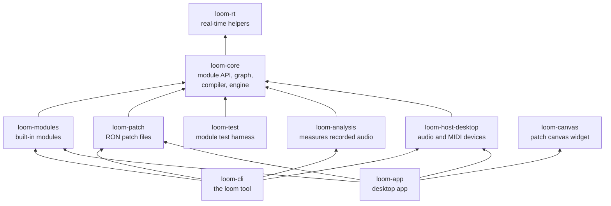
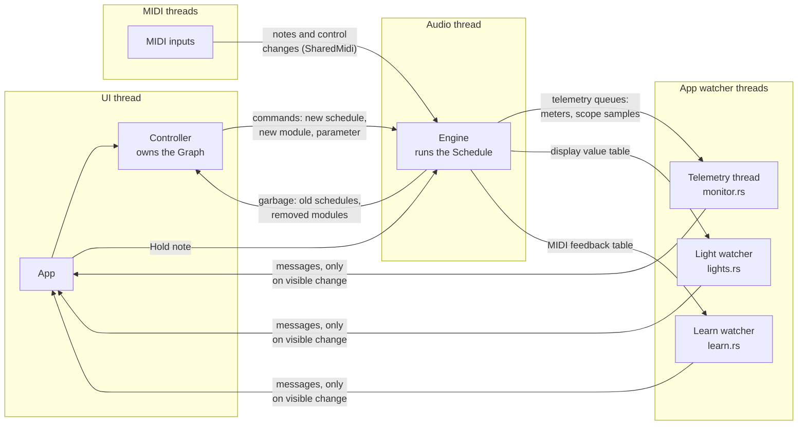

# Architecture

How LoomDSP's code fits together, for people who want to change it. Read [AGENTS.md](../../AGENTS.md) for the hard rules and [CONTRIBUTING.md](../../CONTRIBUTING.md) for the build and review process. The reasons behind each design are in the [ADRs](../adr/README.md).

## Crates



| Crate | Job | Rules |
|---|---|---|
| `loom-rt` | Small real-time helpers: denormal flushing, parameter smoothing. | No dependencies on the rest. |
| `loom-core` | The `Module` trait, the editable `Graph`, the compiler, the `Engine` that runs on the audio thread, and the `Controller` that edits it. | Portable: builds for WebAssembly. No threads, files, or audio APIs. |
| `loom-modules` | Every built-in module, plus integration tests and benchmarks. The `test-modules` feature adds `test_modules`, modules with IDs under `test.` for tests and `loom-app --test-modules`. | Same as `loom-core`. |
| `loom-patch` | Loads, saves, and migrates patch files. | Same as `loom-core`. |
| `loom-test` | The module test harness: renders one module, checks block-size invariance, and compares with reference WAV files. | Desktop only, for tests. Only `dev-dependencies` use it, so it never ships. |
| `loom-analysis` | Measures recorded audio: peak, clipping, the largest step, and DC. `loom analyze` and the app's audio QA tests use the same functions ([audio QA](../design/audio-qa.md)). | Desktop only: it reads WAV files. |
| `loom-host-desktop` | Connects the engine to audio devices (cpal) and MIDI inputs (midir). For development, can also play it from a timer with no device, play it only when a test steps a tape (`AudioOutput::stepped`), and record it to a WAV file across many streams (`Recorder`). | Desktop only. The only crate that knows about audio APIs. |
| `loom-canvas` | The patch canvas: an Iced widget drawn by one custom GPU primitive. | Knows nothing about the engine. It draws a `Scene` and reports gestures. |
| `loom-cli` | The `loom` command: list modules, check, render, play, stress-test, measure WAV files, and act as a virtual MIDI controller for tests. `loom modules --markdown` writes the module help pages in `docs/modules/` ([help pages](../design/help-pages.md)). | |
| `loom-app` | The desktop app: canvas, inspector, audio, MIDI. | Owns the application state. |

The engine crates never depend on UI or device crates. That keeps the same engine usable in the app, the command-line tool, tests, a future plugin, and the browser (NFR-PORT-02).

## Threads

Why the audio thread must never allocate, lock, or wait: [Real-time safety](../learn/real-time-safety.md). Why loops run one sample at a time: [Feedback loops and the unit delay](../learn/feedback-loops.md).



Every arrow into or out of the audio thread is a bounded, lock-free queue (`rtrb`). The audio thread never allocates, frees, locks, or waits (ADR-0001, NFR-RT-01). Memory is allocated on the UI thread, moved to the audio thread inside a command, and moved back as garbage to be freed.

Telemetry for live views also leaves the audio thread through bounded queues: one for meter readings and one for scope samples. The app asks to watch an output port with `Controller::add_probe`. When a telemetry queue is full, the engine drops the new message and counts it; it never waits (NFR-RT-07). Details are in the [telemetry specification](../design/telemetry.md).

The patch transport (tempo, time signature, running, position) lives in the engine, not in the schedule, so editing the patch never moves it ([ADR-0015](../adr/0015-one-transport-per-patch.md)). The controller changes it with commands, applied at buffer starts. At the start of each block the engine fills one shared buffer per transport signal that some unconnected input follows, such as bar phase. Details are in the [clock and transport specification](../design/clock.md).

MIDI inputs and the Hold note button share one queue through a mutex (`SharedMidi`). Only the sending threads take that lock. The audio thread reads the queue without one.

The last stage of every block is the output safety stage: a DC blocker, a limiter at -1 dBFS, and a fade-in, before the final clip to -1 to 1 (ADR-0019, `loom-core/src/safety.rs`). Cables inside the patch are never clipped. Details are in the [output safety specification](../design/output-safety.md).

## Live data from the engine

The UI shows four kinds of live data. Each leaves the audio thread without a lock or an allocation (FR-VIS-04), and each takes the path that suits it.

| Data | How it leaves the engine | Who reads it in the app |
|---|---|---|
| Meter readings and scope samples, from port probes | Two bounded queues (`loom-core/src/telemetry.rs`). Every reading counts, so they queue. When a queue is full, the new message is dropped and counted. | The telemetry thread (`crates/loom-app/src/monitor.rs`). It drains the queues about 30 times a second, turns readings into falling levels, and wakes the UI only when a meter level moves by one of 256 steps. |
| Display values, such as the light for a gate | A latest-value table (`loom-core/src/display.rs`): up to 4 atomic floats per module slot (`MAX_DISPLAYS`), allocated once with the engine. The engine stores after each block, through `Module::displays`. | The light watcher (`crates/loom-app/src/lights.rs`). It reads the lights on screen through a `DisplayReader` about 30 times a second, and wakes the UI only when a light's brightness moves by one of 256 levels. `Controller::display` reads one value on the UI thread. |
| Live values of modulated parameters, for the dot on a knob | A latest-value table like the one for display values (`loom-core/src/live.rs`), with one cell per modulated parameter. | The UI thread, every frame, but only while audio runs and at least one assignment is on. |
| MIDI control changes that move mapped parameters | A feedback table of atomics (`loom-core/src/midi_map.rs`), one entry per MIDI control. The engine applies the mapping itself, then records the value with a sequence number. | The learn watcher (`crates/loom-app/src/learn.rs`), about every 15 ms. When a control change arrives, the app calls `Controller::sync_midi`, which copies the new values into the graph, so the screen shows and saves what plays. |

Why two kinds of path: a meter needs every reading to compute levels, so it uses a queue. A light or a knob dot needs only the latest value, so a table is enough, and a table can never fill up. In a table, each slot or cell also stores who owns it, and a reader checks the owner before and after reading. So a module in a reused slot never shows the values of the module that was there before.

Every message to the app redraws the window. That is why the watchers run on their own threads and send a message only when something on screen changes: an idle patch draws nothing.

A screen edit and a MIDI control change on the same parameter can race. The controller changes the graph at once, but the engine applies the edit at its next buffer. So a screen edit on a mapped parameter carries an edit token, and the engine records when it applied it, in the same sequence as control changes. `Controller::sync_midi` then applies a control change only if the engine received it after the edit. Details are in the [MIDI learn specification](../design/midi-learn.md).

## Life of an edit

What happens when you drag a cable from an oscillator to a filter:

1. **Canvas.** `loom-canvas` hit-tests the ports under the drag and publishes `CanvasEvent::Connect { from, to }`. It does not change anything itself.
2. **App.** `loom-app` handles the event and calls `Controller::connect`, then `Controller::commit`.
3. **Compile.** `commit` compiles the graph into a new `Schedule` (`loom-core/src/compile.rs`): one buffer per output, feedback loops found with Tarjan's algorithm, loops run one sample at a time, and a one-sample delay inserted where a loop has none (ADR-0002). Modules with no path to the audio output, a probe, a light, or a modulated knob are left out and keep their state ([live patching, rule 8](../design/live-patching.md), FR-GRAPH-09).
4. **Swap.** The schedule goes to the engine through the command queue. The engine switches to it at the start of its next buffer. Module instances keep their state, so sound continues without a click or gap.
5. **Redraw.** The app rebuilds its `Scene` from the graph and the compile report (dashed cables show inserted delays). The new scene has a new generation number, so the canvas rebuilds its GPU data once.

The same path carries every structural edit: add, remove, connect, disconnect. Parameter changes skip the compiler and go straight to the engine as one command.

## Drawing the canvas

`loom-canvas` is an Iced widget. Its design goal is that drawing cost follows the number of things on screen, not the number of pixels, because the Retina display on the reference laptop has about 5 million of them ([ADR-0010](../adr/0010-own-patch-canvas.md), [benchmarks](../benchmarks/p1-canvas.md)).

| Piece | File | Notes |
|---|---|---|
| Scene | `scene.rs` | Modules, ports, and cables in world coordinates. Built by the app. Each change gets a new generation number. Also does hit-testing. |
| Camera | `camera.rs` | Pan and zoom. Converts between world and screen positions. |
| GPU data | `gpu.rs` | Turns a scene into instances: one rounded rectangle per tile, header, and port, and one entry per cable. Uploaded only when the generation changes. |
| Shaders | `canvas.wgsl` | Rounded rectangles shade only their own pixels. Cables are curves built in the vertex shader. Pan and zoom change one small uniform buffer, which also holds the opacity of cables that are not in focus. |
| Panel controls | `controls.rs` | Knobs, toggles, radio buttons, buttons, lights, and meters on tiles. Their live values live in `PanelValues`, which has its own generation number and its own GPU buffers. Turning a knob or a light changing rebuilds only these buffers, never the tiles, ports, or cables. |
| Widget | `widget.rs` and `widget/` | The `PatchCanvas` widget and its state. `input.rs` handles mouse and keyboard events, `panel_input.rs` panel controls, focus, and choice pop-ups, and `hover_text.rs` what the pointer is over. `draw.rs` draws the per-frame overlay: selection and hover outlines, the cables of selected and hovered modules in front, and panel text. Text goes through Iced and is skipped when too small to read. `event.rs` holds `CanvasEvent`. |

Without the app's Measure toggle, the window redraws only when something changes.

Shader names must not be reserved words in Metal or HLSL, because wgpu's translator does not always rename them (the `shader_names` test lists them).

## View models for app panels

An app panel that needs tests gets a plain-data view model: a small struct built from app state, which both the window and the UI snapshot read. Then a test of `App::ui_snapshot()` checks what the user sees. We add models one panel at a time; there is no framework ([ADR-0021](../adr/0021-plain-data-view-models-and-keyed-identity.md)).

The inspector is the example (`crates/loom-app/src/inspector.rs`, added in PR #219):

1. **Define the model.** Plain structs and enums with `Debug`, `Clone`, `PartialEq`, and `Serialize`: `Inspector`, `ModuleRows`, `ParamRow`, and so on. Hold what the user reads (labels, value text, slider positions), not widgets. Mark fields that only the widgets need, such as IDs for messages, with `#[serde(skip)]`.
2. **Build it from state.** One method on `App`, here `App::inspector_model()`. All the decisions go here: what is shown in learn mode, which sources are greyed out, how a value is formatted.
3. **Draw it.** A function from the model to an `Element`, here `inspector::view(model)`. Keep it to layout and styling, with no decisions, so nothing the user sees escapes the model. `App::inspector()` is one line: `inspector::view(self.inspector_model())`.
4. **Snapshot it.** Add the model to `UiSnapshot` in `snapshot.rs`. `loom-app --dump-ui` then prints it as JSON too.
5. **Test it.** Build an `App`, change its state, and compare `app.ui_snapshot().inspector` with the expected value.

Widget identity: Iced keeps widget state (a scroll offset, an open list, the canvas camera) by widget type and position in the parent. Keep the structure of `view` stable around stateful widgets. This is why `view` always returns a `stack!`, even when the module browser is closed. For a list of stateful rows that can be added or removed, use `keyed_column` with a stable ID as the key. It does not follow rows that swap places. Use `widget::Id` with operations for focus and scrolling, as the module browser does. ADR-0021 lists the details and the source they were checked against.

## Describing a module

A module is a `static` `ModuleDescriptor` plus a struct that implements `Module`. The descriptor is plain data, written with named fields:

```rust
pub static DIVIDE: ModuleDescriptor = ModuleDescriptor {
    id: "loom.logic.divide",
    version: 1,
    name: "Clock Divide",
    category: "Logic",
    description: "Fires on every Nth trigger. Offset fires earlier in the count. Reset starts the count again.",
    inputs: &[
        PortSpec {
            name: "trigger",
            label: "Trigger",
            signal: SignalType::Gate,
            description: "The triggers to count.",
            default: PortDefault::Value(0.0),
            polarity: Polarity::Unipolar,
            channels: Channels::Downmix,
        },
        // ...
    ],
    outputs: &[/* ... */],
    params: &[
        ParamSpec {
            name: "n",
            label: "Division",
            description: "Fires on every Nth trigger.",
            min: 1.0,
            max: 64.0,
            default: 2.0,
            unit: "",
            options: ParamOptions::DEFAULT,
        }
        .integer(),
        // ...
    ],
    role: ModuleRole::Dsp(|_| Box::new(Divide::new())),
    panel: Panel::new(6, 3, &[Widget::knob(0, 0, "n"), Widget::knob(3, 0, "offset")]),
    displays: &[],
};
```

Names (`id`, port and parameter `name`) are stable IDs that patch files store. Labels and descriptions are text for people and can change at any time (ADR-0016). `loom-modules` checks at compile time that none is empty: `const _: () = loom_core::assert_documented(ALL);`. See [port and parameter text](../design/port-and-parameter-text.md).

An unconnected input reads its `default`: a fixed value, or a transport signal such as `PortDefault::BarPhase`. A module reads the transport inside `process` with `ctx.transport()`, and takes the position at a frame with `TransportInfo::position_at(i)`, so the result is the same at any block size ([clock and transport](../design/clock.md)).

## Where to start

| You want to | Start here |
|---|---|
| Add a module | `crates/loom-modules/src/` (copy a similar module), then `lib.rs`. See CONTRIBUTING.md. |
| Change how the graph runs | `crates/loom-core/src/compile.rs` (one child module per step in `compile/`) and `engine.rs`. Read ADR-0001 and ADR-0002 first. |
| Add a `Controller` method | The group it belongs to, in `crates/loom-core/src/controller/` (modules, cables, assignments, params, midi, transport, displays, audio). The API stays one flat list; each group is its own `impl Controller` block, shown as a section in the API docs. A helper that two groups need goes in `controller.rs`. |
| Change the patch format | `crates/loom-patch/src/lib.rs`. During the early alpha the format stays at version 1, and a change may stop old files from loading: update the example patches in the same change ([AGENTS.md](../../AGENTS.md#project-stage-early-alpha)). From the first release, add a migration and never break old files (ADR-0008). |
| Change how the canvas looks or responds | `crates/loom-canvas/src/`. Keep per-frame work small. |
| Add a panel, button, or setting to the app | `crates/loom-app/src/main.rs`. |
| Support another audio or MIDI case | `crates/loom-host-desktop/src/lib.rs`. |

## Tests

| What | Where |
|---|---|
| Module behaviour | Unit tests next to each module, using `loom_core::testing::run` (or `run_with_transport`). |
| Each module against a reference render, at block sizes 1, 77, and 512 | `crates/loom-modules/tests/reference.rs`, with `loom-test`. References are in `tests/reference/`. |
| No allocation on the audio path, including telemetry | `crates/loom-modules/tests/no_alloc.rs` (debug builds). |
| Every port and parameter has a label and a description | Compile time, `assert_documented(ALL)` in `crates/loom-modules/src/lib.rs`. |
| Module help pages match the descriptors | `committed_pages_are_current` in `crates/loom-cli/src/help_pages.rs`. Regenerate with `mise run help-pages`. |
| Transport and default inputs, including no allocation | `crates/loom-core/tests/transport.rs`, `transport_no_alloc.rs`. |
| Same output at any buffer size, bit-identical runs | `crates/loom-modules/tests/`. |
| Patch loading and round trips | `crates/loom-patch`. |
| Canvas logic and shaders | `crates/loom-canvas` (hit-testing, camera, geometry, shader validation). |
| Layout and parameter mapping in the app | `crates/loom-app`. |
| Pointer and key events reaching the right widget in the app view | `crates/loom-app/src/ui_test.rs`: the headless `Ui` harness sends real events to `App::view`, runs the tasks they return, and finds ports, controls, and text by name. |
| Engine speed | `cargo bench -p loom-modules`. |

CI runs all of them on Linux, macOS, and Windows. The full list of CI jobs is in CONTRIBUTING.md.
