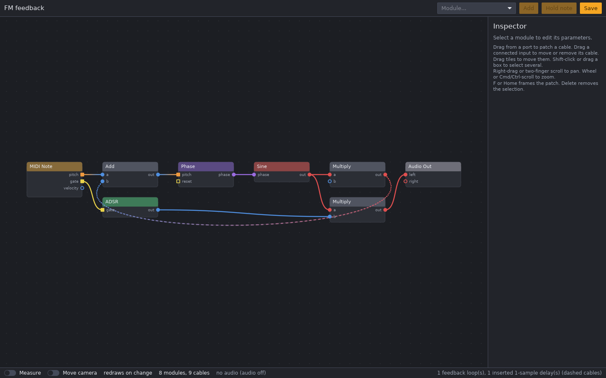

# Getting Started

This guide shows how to run the LoomDSP desktop app, play a patch, and change it while it plays.

LoomDSP is in early alpha. This guide covers the current source build. Check the [roadmap](../product/roadmap.md) for planned work.



## Install and run

### Download (easiest)

1. Open the [latest release](https://github.com/brylie/LoomDSP/releases/latest) and download the file for your computer: `macos-arm64` for Apple Silicon Macs, `macos-x86_64` for Intel Macs, `windows-x86_64` for Windows, or `linux-x86_64` for Linux.
2. Extract it: unzip it, or on Linux unpack the `.tar.gz` file with `tar -xzf`.
3. Open LoomDSP. These early alpha builds are not signed yet, so your system warns the first time:
   - **macOS:** right-click `LoomDSP.app`, choose **Open**, then **Open** again. If macOS still refuses, allow it under System Settings, then Privacy & Security.
   - **Windows:** double-click `loom-app.exe`. On the "Windows protected your PC" screen, choose **More info**, then **Run anyway**.
   - **Linux:** run `./loom-app` in a terminal. If it does not start, run `chmod +x loom-app` first.
4. In the app, open `examples/patches/fm-feedback.ron` from the `examples` folder in the download.

Each download also has a `README.txt` with these steps. To check a download, compare its SHA-256 with the `SHA256SUMS.txt` file on the release page.

### Build from source

If there is no download for your system, or you want the newest changes, you need [Rust](https://rustup.rs) 1.100 or newer.

```sh
git clone https://github.com/brylie/LoomDSP
cd LoomDSP
cargo run --release -p loom-app -- examples/patches/fm-feedback.ron
```

The first build takes a few minutes. Later builds are fast.

On Linux, install the ALSA development package first (`libasound2-dev` on Debian and Ubuntu).

Other example patches are in [`examples/patches`](../../examples/patches). Run the app without a file to start with Transport and space for your own modules.

## Play a note

The FM feedback example above plays while a note is held. Some other patches play on their own while Transport runs.

- **MIDI keyboard.** Connect it and play a note. The app listens to MIDI inputs by default. You can check the bottom bar and choose inputs in **Preferences**.
- **No keyboard.** Click **Hold note** in the toolbar, then **Release note** to stop. Hold note sends an A3 note to the patch's MIDI Note modules. A new patch has only Transport, so open a playable example first.

### If the patch is silent

1. Look at the bottom bar for the active audio device and sample rate. Open **Preferences** to choose the output you want to hear.
2. Follow a signal into **Audio Out**. In a note-driven patch, check that MIDI Note's **Gate** reaches the envelope and that the envelope reaches the amplifier's **Level** input. In a clocked patch, check the **Run** switch on Transport.
3. Right-click an output or a cable and choose **Add scope** or **Add meter**. The probe branches from the signal, so you can check where it stops. Select a module and open **Help** in the inspector to see what its ports expect.

## The screen

| Area | What it does |
|---|---|
| Canvas (centre) | Your patch: modules as tiles, connected by cables. |
| Inspector (right) | Parameters, ports, and help for the selected module. The Matrix tab lists modulation assignments. |
| Toolbar (top) | File name, New, Open, Save, Save As, add a module, hold a note. |
| Bottom bar | Frame rate, module and cable count, audio load, MIDI inputs, and messages. Hover a cut-off message to read all of it. |

## Patching

| To do this | Do this |
|---|---|
| Connect two modules | Drag from an output (right edge of a tile) to an input (left edge), or the other way. |
| Move or remove a cable | Drag it out of the input it feeds. Drop it on another input, or on empty canvas to remove it. |
| Move modules | Drag a tile. Tiles snap to the grid. |
| Select several modules | Shift-click tiles, or drag a box on empty canvas. Cmd/Ctrl+A selects all. |
| Delete modules | Select them and press Delete or Backspace. |
| Add a module | Press **A** with the pointer over the canvas, or double-click empty canvas. Type part of a name, ID, category, or family, pick with the arrow keys, and press Enter. Try **Amplifier** for a VCA, **SVF** or **Ladder** for a filter, and **Envelope** for an ADSR. The module appears where the pointer was. **Add module** in the toolbar does the same at the centre of the canvas. Escape closes the browser. |
| Pan | Right-drag, or scroll with two fingers on a trackpad. |
| Zoom | Mouse wheel, or Cmd/Ctrl and scroll on a trackpad. With the pointer over the canvas, Cmd/Ctrl+0 goes back to 100%, keeping the point under the pointer in place. |
| Show the whole patch | Press F or Home. |

Patching takes effect while audio plays. The engine switches the graph between buffers and fades changes where it can. The bottom bar shows load and dropouts. See [live patching](../design/live-patching.md) for the rules.

## Reading a patch

Signals flow from left to right. Each port's colour shows its signal type, and its shape gives a second cue for people who do not see all colours:

| Signal | Colour | Port shape | Typical range |
|---|---|---|---|
| Audio | Red | Round | -1 to 1 |
| Modulation | Blue | Round | -1 to 1, or 0 to 1 |
| Pitch | Orange | Square | 0.1 per octave, 0 is middle C |
| Phase | Purple | Round | 0 to 1, wrapping |
| Gate | Yellow | Square | High above 0.5 |

Any output can connect to any input. The colour, shape, and range help you choose a match. The signal rules are in [ADR-0007](../adr/0007-polymorphic-signal-model.md).

- **Filled ports** have a cable. **Rings** are free.
- **Cables run behind the tiles, dimmed.** Point at a cable, a port, or a module to bring its cables to the front at full brightness. Selected modules keep their cables bright. Nothing else changes as you move the pointer, so you can follow one connection across a busy patch.
- **A dashed signal cable** marks a one-sample delay inserted to break feedback. You can choose the break yourself with **1-Sample Delay**. See [feedback loops](../learn/feedback-loops.md).
- **A clock mark** identifies a Transport default on an unpatched input. Hover the port to see its default. For example, Euclidean Rhythm in Phase mode follows the bar phase with no cable. An oscillator's Phase input uses the oscillator's own phase by default. See [normals](../learn/normals.md).
- **A voice bundle** carries several voices on one cable. Hover an output to see its voice count. **Voice Merge** can sum those voices for a scope or an audio path.
- **Zoomed out,** tiles hide their text so large patches stay readable and fast.

## Editing parameters

Click a tile to select it. The inspector shows its parameters. Frequencies and times use a logarithmic scale, so the middle of the slider is musically in the middle. Whole-number parameters, such as a MIDI channel, snap to whole values.

Click a numeric control and type an exact value. For example, click SVF Cutoff, type `1.6k`, then press Enter to set 1,600 Hz. Undo returns to the previous value.

## Follow modulation and open a sub-patch

Open [`modulation.ron`](../../examples/patches/modulation.ron) and find the badge next to the LFO's output. Hover to see where the assignment goes, then click the badge to pin the dashed modulation line. Open **Matrix** to see the source, target, depth, and polarity. Escape clears the pin. To make an assignment of your own, drag an output directly onto a knob. See [modulation](../design/modulation.md#seeing-assignments).

For a playable voice with its wiring tucked inside, add **Synth voice** from the module browser. Patch MIDI Note's Pitch, Gate, and Velocity to the voice, then patch its output into Audio Out. Play a note or use **Hold note**. Double-click the voice's title to see its parts. Use the breadcrumb to go back up. The tile's context menu can swap compatible parts such as its filter. See [built-in sub-patches](../design/sub-patches.md#built-in-abstractions-agreed-2026-11-14).

## Saving

**New**, **Open**, **Save**, and **Save As** (Ctrl or Cmd with N, O, S, and Shift+S) work on `.ron` patch files, including module positions. The window title shows the file name, with a `*` in front when you have unsaved changes. The app asks before it throws changes away.

Bundled examples open as untitled copies. **Save** asks where to write your copy. For your own patch, Save writes to the current file and **Save As** lets you choose a new path. Saving rewrites the [RON](../adr/0008-patch-format-ron.md) text and drops its comments. Keep the source example handy if you want to reread its wiring notes. See [file commands](../design/files.md#defaults-for-the-dialogs).

**Recent** lists the last 10 patches. You can also drag a patch onto the window. On Wayland, use **Open** or **Recent**. Patch files are plain text, so you can read, edit, and keep them in git.

## Keep going

- [Learn](../learn/README.md) explains the signals and techniques behind these patches.
- [Module help](../modules/README.md) lists ports, parameters, and examples.
- [Contributing](../../CONTRIBUTING.md) shows how to report a problem or add an example.
