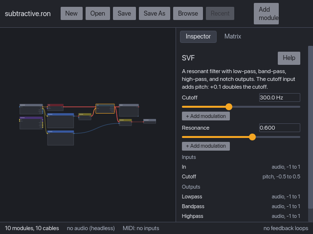
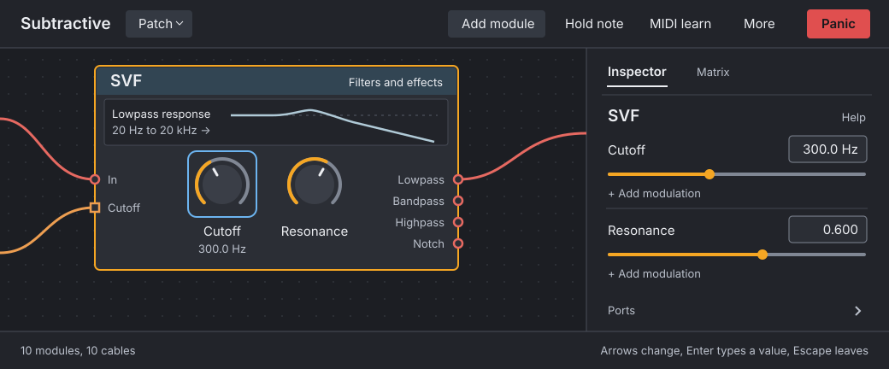

# LoomDSP desktop UX audit and design language

19 November 2026 · Desktop revision `df443681` · Research and design proposal

LoomDSP feels most like an instrument when a player turns a knob. In Subtractive, I clicked Cutoff, typed `1.6k`, and pressed Enter. The inspector read **1600 Hz**. One Undo restored **300.0 Hz**. The sound parameter, its displayed unit, and its undo history all described the same action. That is the standard I would apply to opening a patch, following a cable, mapping a controller, and recovering from silence.

**Three changes have the highest release value.** Put playing and silencing within reach at every window size, give a new player a short path to first sound, and make patching possible without a precise drag. Then refine the hierarchy of every shared control.

## What the audit covered

I built this checkout on macOS, rendered whole windows at 1280 × 800 and 640 × 480, and drove a running window with the control channel, fake audio, isolated preferences, and hardware MIDI disabled. I checked a new patch, an empty module search, a held note, a numeric edit and Undo, Learn armed on Cutoff, and the Panic command. I compared the results with the panel descriptors, colour tokens, window layout, and accessibility rules. The earlier desktop play test supplies separate evidence from real MIDI and audio loopback. [Play test](2026-11-19-desktop-playtest.md) · [Control channel](../design/control-channel.md)

The captures show the actual renderer. A whole-patch offscreen capture fits the graph and can show a different zoom from opening the file interactively. The design study below enlarges a detail for discussion. No musician was observed in this audit. Speech output, stage visibility, physical pointing effort, and enjoyment still need sessions with people.

Reproduce the two saved views from the repository root with a GPU available.

```sh
cargo run -p loom-app -- examples/patches/subtractive.ron --select 4 --size 640x480 --screenshot-window /tmp/compact.png
cargo run -p loom-app -- examples/patches/subtractive.ron --select 4 --zoom 1.35 --focus 4:cutoff --size 1280x800 --screenshot-window /tmp/focus.png
```

## Findings in release order

| Priority | Where the experience breaks | What to change and how to tell it worked |
|---|---|---|
| Release blocker | **The narrow window sacrifices playing controls first.** At 640 × 480, New, Open, Save, Save As, Browse and Recent are visible. Add module wraps. Hold note and Panic are offscreen. The right panel still takes 280 logical pixels. A player using the pointer loses the emergency action. | Reserve a stable trailing position for Panic beside the playing actions. Gather file and library commands under **Patch** and expose secondary commands through a named overflow menu. Allow the inspector to close at compact widths. At 640 × 480 and 1280 × 800, open every displaced command and activate Panic in one pointer press with the canvas active. Check its global shortcut with a field or dialog open. [Window layout](../../crates/loom-app/src/view.rs) · [Panic behaviour](../design/panic.md) |
| Release blocker | **The first note looks successful on a silent patch.** With the engine running, a fresh patch changed Hold note to Release note. Its only tile was Transport. The status said “no feedback loops”. The unselected inspector led with authors, tags and licence. The screen gives a player good places to describe an instrument they have yet to hear. | Offer **Play an example** on the fresh patch, keep **Add module** available for a blank build, and explain the missing output route in that state. Opening the example should leave the decision to sound it with the player. With audio available and no MIDI hardware, a newcomer should open a bundled voice, hear it, release it and change one control without opening a file picker or reading the guide. Verify the audio with a recording. [Getting started](../guide/getting-started.md) · [First-sound play test](2026-11-19-desktop-playtest.md) |
| Release blocker | **A player can adjust a filter by key but still needs a drag to wire it.** The guide teaches port-to-port dragging. The snapshot reports a port hit radius of 9 world units, an 18-unit diameter at 100% zoom. The graph outline and upstream/downstream navigation have an agreed design. Making or removing a cable by key is separate planned work. | Give each port a named connection action with a searchable endpoint list, usable by keys, screen reader, or two separate pointer clicks. Include the current source and the unconnected default. Test making, replacing, cancelling and undoing a connection at 100% and at overview zoom. Compare the result in the graph, spoken description and audio path. [Canvas accessibility and editing scope](../design/canvas-accessibility.md) · [Cable editing work](https://github.com/brylie/LoomDSP/issues/524) |
| High | **A focus change takes the knob's name away.** In the filter capture, focusing Cutoff replaces its caption with “300.0 Hz”. That text reads straight into “Resonance”. The blue ring tells me where the keyboard is, but I have to look at the inspector to confirm what I am editing. Nearby, two filled “+ Add modulation” buttons compete with the values. | Keep a stable control name and give its focused value a reserved line or anchored readout clear of adjacent controls and ports. Make adding modulation a quiet, always-reachable row action. Give an existing assignment its source and depth. Check the shortest and longest formatted values, including a modulated or mapped parameter, across built-in panels and exposed controls. [Focus capture](images/2026-11-19-focused-filter.png) · [Inspector rows](../../crates/loom-app/src/inspector.rs) |
| High | **Zoom solves different problems on each side of the window.** Zooming in makes the tile legible. It leaves the inspector at its 11–13 pixel text sizes for details, body and controls. In the other direction, the earlier play test followed a pinned route until its endpoint labels became bars. | Give the whole application a text/spacing scale. At overview zoom prioritise the selected name and the two ends of the route being followed. Test a long port name, a long patch name, Help, a search result and an error at 200% text size. A player should be able to name both ends of the selected route and reach every action. [App text tokens](../../crates/loom-app/src/style.rs) · [Route observation](2026-11-19-desktop-playtest.md) |
| High | **Keyboard position has two visual conventions.** A tile control and the runtime's focus ring use blue. A focused matrix cell or keyboard-highlighted menu row can use the primary amber edge. The same hue already carries the base value, tile selection and active Learn mode. This makes a player's next keystroke harder to predict as they cross surfaces. | Use the same outside ring for the element that owns the keys. Keep list highlight inside the list, tile selection at the tile edge, and a persistent word for Learn. Test keyboard focus, selected item, Learn and hover independently and together. Moving between them should change neither control bounds nor the patch. [App styles](../../crates/loom-app/src/style.rs) · [Canvas palette](../../crates/loom-canvas/src/theme.rs) |
| Medium | **The browser understands descriptions but misses a musician's vocabulary.** Searching for `VCA` in the running app returned zero rows. Clearing the query is the only suggestion. The getting-started guide already translates VCA to Amplifier, so the player has to learn that translation outside the search box. | Index the same small set of musical aliases the guide teaches, under the original module names. Try `VCA` and `ADSR`, an exact ID, and an unknown term. Check result ranking, spoken result count and recovery after zero matches. [Search rules](../design/module-browser.md) · [Guide vocabulary](../guide/getting-started.md) |
| Low, inexpensive | **Some feedback sounds like a diagnostic.** The fresh patch reads “1 modules, 0 cables”. “No feedback loops” describes a compiler result while a first-time player is trying to get a note. | Inflect counts and reserve prominent status text for the current action or a problem the player can address. Keep feedback-loop details available when relevant. Test 0, 1 and 2 items, with an active error taking precedence over routine hints. [Stats model](../../crates/loom-app/src/bars.rs) · [Status rules](../design/visual-system.md) |



## Proposed design language

**Give each module a picture of what it does.** On a dark stage, an envelope should be recognisable by its rise, hold and release. A pulse should show how much of its cycle stays high. The graphite field and family header tie the panels together. The geometry inside the panel tells them apart, even in greyscale. Keep amber for the part the player can change and exact values within reach for tuning. [One design language](../adr/0025-one-design-language-and-derived-panels.md) · [Panel layout](../design/panels.md#panel-layout)

### What should change in the picture when I turn this?

Choose the picture by asking what a musician would want to predict. Envelope, LFO and Ladder already put a calculated shape above their controls. Pulse currently presents Tune, Octave and Width as three knobs. Euclidean Rhythm presents Steps, Hits and Rotation as three numbers. Those last two are good candidates for the next design trial. [Existing shape previews](../design/panel-widgets.md#read-only-shape-preview) · [Pulse panel](../modules/loom.osc.pulse.md) · [Euclidean Rhythm panel](../modules/loom.gate.euclid.md)


| What the player wants to know | What the tile should show | What an edit should do |
|---|---|---|
| **Envelope** · How does the note begin and end? | Level vertically, note progression horizontally. Leave room for the sustain plateau in ADSR mode. Its duration depends on when the player releases the gate. | Increasing Attack lengthens the rise. Increasing Sustain raises the plateau. The separate Level light reports where the sounding note is now. [Envelope](../modules/loom.env.envelope.md) |
| **LFO** · What movement repeats? | One cycle around a visible zero line. Sine has rounded peaks, Triangle has corners. Keep a full cycle in view at every rate. | Shape changes the contour. Rate changes how often that contour repeats. Show Hz in Free mode and Cycles against the incoming phase in Synced mode. [LFO](../modules/loom.mod.lfo.md) |
| **Pulse** · How long is the high part? | One schematic cycle with its high and low sections on the same baseline of time. Width 0.25 puts the falling edge a quarter of the way across. | Increase Width to 0.75 and the edge moves right, with the cycle endpoints fixed. Trial a horizontal grip on that edge, bound to the existing Width parameter. Its single focus stop, arrow steps, typed value and Undo should work like the shared numeric control. [Pulse](../modules/loom.osc.pulse.md) |
| **Euclidean Rhythm** · Where do the hits fall? | Evenly spaced step ticks with taller marks for hits. At 3 in 8, the player can see the long, long, short gaps across the wrap. | Rotation 1 moves hits from steps 1, 4, 7 to 2, 5, 8. Rotation preserves the number and spacing of hits. Keep this generated strip read-only. Individual editable cells belong to a pattern the player authors. [Euclidean Rhythm](../modules/loom.gate.euclid.md) |

**Make the gesture legible.** A calculated preview gets a bounded surface, a caption and a line without handles. Dragging its background keeps the tile's move gesture. A measured display such as Scope draws incoming samples against a time window and zero line. With a silent connected input, zero is an informative reading. An editable drawing gets a visible grip only on the part that accepts an edit. In the Pulse study that grip moves horizontally, changes one named parameter and can take keyboard focus. Direct parameter handles are a proposal to test. The existing preview convention and shared precision controls give a working first step. [Display and editor behaviour](../design/panel-widgets.md)

**Give the picture a spoken equivalent.** For Pulse, “Width 0.25, high for one quarter of each cycle” communicates the relationship. For Rhythm, “3 hits in 8 steps, on 2, 5 and 8” lets a player hear what Rotation changed. Put the description on the existing control or read-only figure as appropriate. Read it on request or after a deliberate edit. A player following the rhythm can use a separate current-step indicator. At middle zoom preserve the contour or hit pattern; at far zoom use the existing tile overview. A calculated shape can stay still until a setting changes.



*Filter study.* Subtractive uses the SVF's Lowpass output. The proposed preview names that output because the same module also offers Bandpass, Highpass and Notch. Frequency increases from left to right on a logarithmic scale. Raising Cutoff moves the bend toward the treble; raising Resonance emphasises frequencies around the bend. The picture explains the edit, the knob is easy to play, and the inspector gives the exact frequency. The line illustrates the intended relationship. A shipping preview would need to derive the response from the filter and identify the displayed output when several are connected. [Current view](images/2026-11-19-focused-filter.png) · [SVF outputs](../modules/loom.filter.svf.md)

**Test whether the drawing teaches.** At normal tile size, ask a new player to predict which way to move the pulse edge to keep the signal high longer, then make the edit. Ask them to identify which of two envelopes swells more slowly and tap the displayed 3-in-8 rhythm. Ask which figures they expect to drag. Repeat the tasks in greyscale and through the accessible descriptions. Record the prediction and the first attempted gesture. If a player tries to grab a static crest, revise the cue before rolling it out to more modules.

### What is the patch doing now?

The contour answers “what shape have I set?” A moving mark answers “where is this voice now?” Put both in the same coordinate system. A player learning an envelope can hold one note and watch it settle, then play another and see a new attack while the first note sustains. The grips used for editing keep their own shape and focus treatment. Live marks carry voice numbers and let pointer gestures pass through to the panel. [Interactive envelope study](images/envelope-in-play.html)

**Read the envelope in two directions.** The horizontal position identifies the stage and progress through that stage. Vertical position is the voice's current output level. A sustained voice stays on the plateau until its gate falls. A released voice starts at the height it actually reached, crosses the release region, and disappears at idle. Release a note halfway through Attack and its marker can appear below the reference release line. That gap tells the player the note was cut short. A retrigger starts Attack at the current height. AD mode uses only Attack and Decay. A zero sustain level can still have an active voice. [Envelope behaviour](../modules/loom.env.envelope.md) · [Envelope stage transitions](../../crates/loom-dsp/src/envelope.rs)

**Keep each voice recognisable.** Use the voice slot as the identifier across frames. Show all active envelopes, including release tails. A slot that is reused follows its new gate and the engine's actual envelope state. Two voices in the same place share a mark with a count or identifiers; an on-demand list names each voice's stage and level. At overview zoom, use a compact summary such as “3 active · 1 releasing”. The detailed view should also work with all 16 slots active. Stereo copies of one voice should not read as additional notes. [Voice allocation and display rules](../design/polyphony.md)

**Use the same convention where it answers a musical question.** On LFO, a phase marker on the cycle distinguishes a rising signal from a falling one at the same level. On Euclidean Rhythm, an underline shows the current step, including when it lands on a rest; raised hit marks continue to show the programmed rhythm. On a modulated filter, the existing outer arc and live dot show how far Cutoff is moving around its base setting. A frequency-response preview describes the filter. A scope measures a signal. Each display should name the quantity behind its moving mark. [LFO](../modules/loom.mod.lfo.md) · [Euclidean Rhythm](../modules/loom.gate.euclid.md) · [Modulation display](../design/modulation.md)

**Prototype evidence and implementation boundary.** The study plays a silent, scripted three-voice phrase with a linear envelope. Pause or scrub to inspect it. At 1.60 s, voices 1, 2 and 3 are in Sustain, Release and Attack respectively. Replaying after the end includes voice 2's early release and retrigger. In the app today Envelope publishes a single level, and the polyphony spec says displays read voice 1. Shipping this proposal needs an explicit exception for a per-voice activity display and bounded snapshots of voice slot, stage, stage progress and output level from the engine. Inferring stage from amplitude misses the distinction this design is meant to teach. [Current module display](../../crates/loom-modules/src/env.rs) · [Telemetry](../design/telemetry.md)

**Verify against the playing patch.** Use staggered notes, two voices landing on the same sustain level, a release during attack, a retrigger during release, and a one-shot AD envelope. Compare the visible and accessible state to the engine snapshot at the same frame. With a full chord, check that voice counts stay legible and releasing the final note clears every marker once its tail ends. Sample only as fast as the visible display needs; a stage shorter than a display frame may pass between readings. Idle, hidden and unchanged displays should not keep the UI awake. Offer a stationary stage summary for reduced motion and an on-demand spoken reading such as “3 active voices: one attacking, one sustaining, one releasing”. Reserve announcements for user requests instead of narrating a chord frame by frame.

### Colour and material

| Meaning | Appearance to use | Companion cue |
|---|---|---|
| Workspace, app panels, module body | Existing graphite field `#1C1E23`, shell `#22242A`, tile `#2B2E35`. Use a flat surface for each level. Reserve shadow for a floating menu that crosses other content. | A persistent edge or a gap separates regions. Family colour stays in the header. The browser carries the family name as text. |
| Editable number | Existing amber `#F5A623` for the filled arc or slider travel. Preserve the knob's light pointer and its small start mark at minimum. | Stable name, formatted value and unit. A light and a meter have a reading and no handle. |
| Selection, hover, focus | Keep a thin selection edge around the **module**. Hover lifts the pointed part. Proposed keyboard focus uses the existing blue `#6CB4F0`, 2 logical pixels wide with a 2-pixel gap where space permits. | Focus encloses the **control** that will receive a key. A selected row retains its selected mark when focus moves elsewhere. |
| Modulation and learn | Pink `#E86AC8` sits outside the base arc. Keep a moving dot for the live value and a named source/depth in the inspector. | Show **Learning** and the armed target. Entering the mode changes the action a control offers, so its instruction must change too. |
| Activity and danger | Keep small green lights for activity and the red **Panic** button in a fixed place. Keep signal colours on jacks and cables. | A warning names the condition, such as **Output clipped**. A lit clip marker has a corresponding reading. Cable endpoints expose type and name. |

The existing dim label on the tile measures **5.18:1** and the focus blue **6.10:1** against the tile body. The unused part of the knob track measures **1.51:1**. Where that track carries the remaining travel, trial `#808794` (**3.76:1**) and check it at minimum, midpoint and maximum. Thin lines also need inspection at actual size. Treat 4.5:1 for ordinary text and 3:1 for necessary graphical cues as desktop design targets. [Canvas tokens and contrast calculation](../../crates/loom-canvas/src/theme.rs) · [W3C guidance on meaningful graphical cues](https://www.w3.org/WAI/WCAG22/Understanding/non-text-contrast.html)

### Type, spacing and composition

- **Give numbers a steady place.** Use the application's sans-serif face, regular for names and medium or semibold for section titles. Use tabular digits for changing readings, align the values to the right in inspector rows, and format them with the same parameter formatter on every surface. Check the transition from **999.9 Hz** to **1000 Hz** for layout shifts.
- **Give the shell a small spacing scale.** Trial 4 logical pixels within a label/value pair, 8 between related controls, 12 inside a panel, and 16 between sections. Start with a 32-pixel command row target and a 4-pixel control radius. Use the canvas's existing world-unit grid for module geometry. A port's hit area can exceed its drawn socket if neighbouring targets remain unambiguous.
- **Use type to rank the work.** Trial 14-pixel body and controls, 12-pixel supporting detail and 18-pixel section headings at default shell scale. Reserve small text for information also available at the chosen reading size. Compare these candidates with the existing 11/12/13/15/18 scale at both window widths before choosing defaults.
- **Repeat the reading order.** On Envelope, show the shape, then mode, then Attack through Release. On SVF, give Cutoff and Resonance the play row. On a mixer, align faders and meters so levels can be compared. Put mode-dependent controls where players expect them and keep jacks anchored when a mode changes. On a sub-patch surface, carry through the inner control's unit, direction, focus and undo behaviour. [Panel layout rules](../design/panels.md#panel-layout)
- **Let movement explain sound.** Give an active gesture immediate local feedback. Reserve continuous movement for a signal, position or meter the player is watching. Keep text, toolbar chrome and surrounding controls still while values move. For reduced motion, trial holding a trace while retaining its numerical reading and timely clip warnings. Compare idle redraws and dense-patch panning with the existing performance budget. [Performance requirements](../product/non-functional-requirements.md)

### Interaction and accessibility

| Player intention | Pointer | Keys and assistive technology | Feedback |
|---|---|---|---|
| Change one number | Drag, use Shift for a fine change, or click the inspector value field. | Focus the named control, step with arrows or enter a value. Expose a slider with the same value, bounds and unit. | Keep the name visible during the edit. Enter commits once. Escape cancels a draft. Invalid text stays available to correct. Undo names the parameter. |
| Choose a mode | Use a switch for two states or the shared segments or choice list for named alternatives. | Report the chosen option and use the control's existing step or activation action. Give each item its visible name. | The thumb moves or the active segment gains a mark. Keep selection visible after hover and focus leave. |
| Connect and trace | Keep direct cable dragging. Add point-and-click endpoint selection, with an explicit cancel. | Provide the same endpoint list by key. Use the agreed outline for following the route and returning to the previous position. | Preview both endpoints by module and port. Confirm connection or restored input default. An abandoned connection leaves the patch and undo history intact. |
| Open, close or recover | Put the usual action first and secondary actions in predictable places. | Name the dialog, focus its first useful action, contain navigation while modal, and restore focus to the opener. Preserve global Panic. | An empty library offers a way in. A failed save names what failed and how to retry. A lost device stays visible until recovery. Announce a new problem once. |

Use one model for the name, value, enabled state and reason everywhere the player encounters a control. For dense geometry, test a 24 × 24 logical pixel target or sufficient spacing or an equivalent larger action. Include a **single-pointer** alternative to dragging. A keyboard shortcut alone does little for someone using a head pointer. Use W3C's guidance as review criteria for this native desktop app. [UI layer](../design/ui-layer.md) · [Target size and exceptions](https://www.w3.org/WAI/WCAG22/Understanding/target-size-minimum.html) · [Dragging alternatives](https://www.w3.org/WAI/WCAG22/Understanding/dragging-movements.html) · [Text resizing](https://www.w3.org/WAI/WCAG22/Understanding/resize-text.html)

## Rollout and release checks

1. **Start with one playable example and the compact shell.** Review the fresh state, output-unavailable state and overflow layout together. Record first sound, then silence it. Confirm that opening a saved user patch bypasses the starter. Use the existing starter and compact-window work as the owners of these changes. [Starter](https://github.com/brylie/LoomDSP/issues/505) · [Compact layout](https://github.com/brylie/LoomDSP/issues/495)
2. **Prove the language on Pulse and the filter.** Trial a read-only pulse beside the editable-edge concept using the prediction task above. Settle the shared gesture before adding any parameter handle. Carry the agreed Cutoff design through the shared widgets and shell tokens. Check the tile, inspector, exposed control, matrix target, Learn and Help. Then apply it to a choice on Envelope, a dense level display and the all-widgets patch. Test focus and hit geometry in the headless harness and keep selected, focused, disabled, error and Learn captures at both pixel densities. [All-widgets fixture](../../examples/dev/test-widgets.ron) · [UI migration](../design/ui-layer.md)
3. **Verify with musicians before calling it ready for general use.** Suggested first round: a new modular player, a performer who regularly maps hardware, a keyboard-only player, and screen-reader and low-vision users. Ask them to make first sound unaided, patch a cable, type and undo a value, follow a route, save and reopen, and recover from a lost output. Record task completion, time to first note, missed targets, and where help was needed. Ask which action felt uncertain and why. Initial targets to test are first sound within one minute, one-action Panic from the playing view, and completion of the patching task with each supported input method.
4. **Repeat on each supported desktop platform.** Pair snapshots with actual VoiceOver, NVDA and Orca sessions. Verify that spoken names and units match the visible controls, focus returns after menus close, telemetry does not drown out commands, and 200% reading size preserves access to each task. Check the live window during edits and with a busy patch. A still capture cannot reveal a flicker or a delayed control response.

This snapshot proposes changes for review. The visual system, panel, browser and canvas-accessibility specifications are the places to agree behaviour before implementation.
