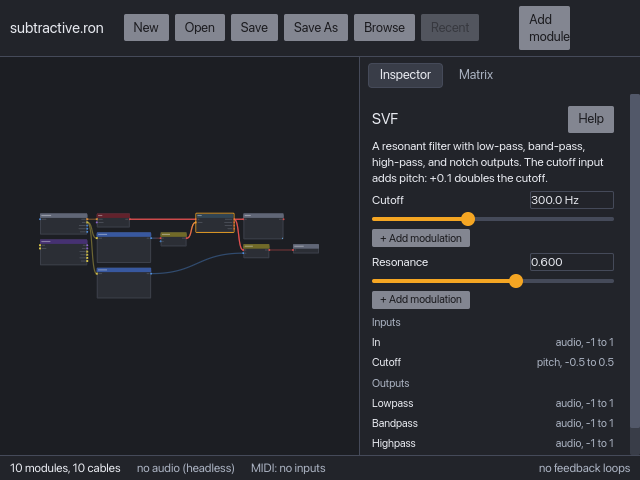

# LoomDSP desktop UI audit

**19 November 2026 · main at `447bb01fe64116141f712ea002b5c8e2739d2e15`**

The toolbar’s Open button visibly darkens for one frame when a scripted key press reaches the Tags field. It stays enabled throughout. Physical keyboard users report a similar flash across inspector fields and toolbar buttons. Other priorities are keeping Panic visible in compact windows, opening the exact patch a player selected, preserving a cut selection when the clipboard fails, and making output warnings audible to a screen reader.

This review follows input, rendering and accessibility across the desktop app, its Iced bridge, the canvas, and the Loom UI runtime. It also covers patch browsing, editing, library refresh, and the fidelity of the UI test harness. Priorities reflect player impact. Each finding identifies the evidence and a check for the proposed change.

## 1. Unrelated controls flicker during typing

**High priority.** The reported symptom spans inspector text fields, toolbar buttons, and typing into a module knob’s value editor. The inspector and the knob use different editing implementations. Open is a useful reference button because its toolbar model enables it unconditionally. [Open button model](https://github.com/brylie/LoomDSP/blob/447bb01fe64116141f712ea002b5c8e2739d2e15/crates/loom-app/src/toolbar.rs#L93)

**Running-window check.** On macOS, open `examples/patches/subtractive.ron` with audio disabled. Enter `saw` in the patch inspector’s Tags field. Click the cutoff knob on module 4 and send the digit keys `4`, `8`, `0`. The snapshot confirmed that the canvas editor held `480`. The 102 × 54 pixel Open-button captures were byte-identical before typing, after Tags, and while the knob editor held the new text. The control channel waits for frames before answering a screenshot request, so these images establish that the button has the same appearance after the input settles. They cannot determine what the user saw on the intervening frames. [Control-channel timing](../design/control-channel.md)

**Frame-by-frame GPU check.** With Tags focused, a temporary probe sampled the interior of the enabled Open button at the same relative point on successive offscreen renders. A regular harness key press and release left the settled pixel unchanged. Injecting one key through the control channel’s queue reproduced a one-frame darkening. The probe was removed after the measurement.

| Open button sample | Red | Green | Blue |
| --- | ---: | ---: | ---: |
| Before typing | 131 | 134 | 145 |
| After ordinary harness typing settled | 131 | 134 | 145 |
| Scripted key-down frame | 82 | 85 | 94 |
| Scripted key-up frame | 131 | 134 | 145 |

**Why scripted input flashes.** The bridge builds an Iced view for a frame, runs its redraw update, then draws it. A newly built Iced button obtains its visual status in that update and otherwise draws with its disabled style. While a script is typing, the pointer wrapper delivers an injected key inside the redraw, then merges the key’s shell into the redraw’s shell. Iced’s merge carries across the “event captured” flag. An enabled button that receives this flag returns before setting its status. This can change how an unrelated button is painted even while its app model stays enabled. Native keyboard events enter through a separate window-event path. The cause of the physical-keyboard report remains open. [Event injection](https://github.com/brylie/LoomDSP/blob/447bb01fe64116141f712ea002b5c8e2739d2e15/crates/loom-app/src/pointer.rs#L539) · [Window draw](https://github.com/brylie/LoomDSP/blob/447bb01fe64116141f712ea002b5c8e2739d2e15/crates/loom-app/src/iced_bridge/window.rs#L417) · [Native input](https://github.com/brylie/LoomDSP/blob/447bb01fe64116141f712ea002b5c8e2739d2e15/crates/loom-app/src/iced_bridge/window.rs#L285) · [Pinned Iced shell](https://docs.rs/iced_core/0.14.0/src/iced_core/shell.rs.html#160-172) · [Pinned Iced button](https://docs.rs/iced_widget/0.14.2/src/iced_widget/button.rs.html#295-376)

**Fix and verification.** Give each scripted key its own input turn or propagate its messages, invalidations and redraw requests without copying its captured flag into the redraw. For the native bug, record every presented frame across key-down, repeat, key-up and caret blink. Track the widget status and pixels of Open and a second, unfocused inspector field, with the pointer stationary and no transport activity. Run both a patch metadata edit and a canvas knob edit through native keyboard input. A passing regression keeps the surrounding controls stable through every frame while the text, caret and edits continue to work. The existing enabled-button test checks one capture. [Existing regression](https://github.com/brylie/LoomDSP/blob/447bb01fe64116141f712ea002b5c8e2739d2e15/crates/loom-app/src/ui_test/tests.rs#L2746) · [Frame presentation](https://github.com/brylie/LoomDSP/blob/447bb01fe64116141f712ea002b5c8e2739d2e15/crates/loom-ui/src/shell/gpu.rs#L213)

## 2. A compact window hides toolbar commands, including Panic

**High · reproduced in the renderer.** At 800 × 600, the toolbar shows Panic, but Undo, Redo, MIDI learn and Preferences have disappeared. At 640 × 480, both Hold note and Panic disappear. The app permits either window size. The toolbar puts the patch name and all command groups in one row with no overflow menu. A player using the pointer loses the silence control precisely when trying to reach it quickly. The Panic keyboard shortcut is still available. [Window constraints](https://github.com/brylie/LoomDSP/blob/447bb01fe64116141f712ea002b5c8e2739d2e15/crates/loom-app/src/iced_bridge.rs#L315) · [Toolbar layout](https://github.com/brylie/LoomDSP/blob/447bb01fe64116141f712ea002b5c8e2739d2e15/crates/loom-app/src/view.rs#L239) · [Command groups and Panic shortcut](https://github.com/brylie/LoomDSP/blob/447bb01fe64116141f712ea002b5c8e2739d2e15/crates/loom-app/src/toolbar.rs#L139)

Reserve space for Panic at compact widths and move lower-priority actions into a labelled overflow menu with keyboard and screen-reader access. Verify that every action remains reachable at 640, 800 and the default width, including inside a sub-patch where Save to library adds another button. To reproduce the picture, render the subtractive patch with `--screenshot-window compact.png --size 640x480 --select 4`.

## 3. A delayed activation can open a different patch

**High · correctness.** In *Your patches*, a visible row has a stable key, but both the pointer action and the screen-reader action carry its numeric position. An arriving scan batch can reorder the list by modification time. If a player activates A at index zero and a newer B arrives above it before the action is handled, the handler opens B. The unsaved-changes prompt still applies, but its presence does not ensure the intended file opens. [Pointer action](https://github.com/brylie/LoomDSP/blob/447bb01fe64116141f712ea002b5c8e2739d2e15/crates/loom-app/src/patches.rs#L700) · [Screen-reader action](https://github.com/brylie/LoomDSP/blob/447bb01fe64116141f712ea002b5c8e2739d2e15/crates/loom-app/src/patches/access.rs#L70) · [Batch handling](https://github.com/brylie/LoomDSP/blob/447bb01fe64116141f712ea002b5c8e2739d2e15/crates/loom-app/src/patches.rs#L517) · [Open handler](https://github.com/brylie/LoomDSP/blob/447bb01fe64116141f712ea002b5c8e2739d2e15/crates/loom-app/src/patches.rs#L578)

Carry the file path or stable row ID from activation through dispatch. Resolve it against the current browser instance, and ignore an action if its row has disappeared. Test by queuing a click on A, inserting newer B, then delivering the click. Repeat with the screen-reader action and with the browser closed and reopened.

## 4. Cut can remove modules when the clipboard write fails

**High · edit integrity.** Cut deletes the selected modules and reports success before the clipboard effect runs. The desktop service has no success result and silently returns if no clipboard is available. A player can cut a group in one patch, open another, and discover that Paste has no copy of the group. Undo provides recovery while the original editing session is still open. Copy announces success prematurely for the same reason. [Cut command and effect](https://github.com/brylie/LoomDSP/blob/447bb01fe64116141f712ea002b5c8e2739d2e15/crates/loom-app/src/editing.rs#L722) · [Selection deletion](https://github.com/brylie/LoomDSP/blob/447bb01fe64116141f712ea002b5c8e2739d2e15/crates/loom-app/src/editing.rs#L775) · [Desktop clipboard](https://github.com/brylie/LoomDSP/blob/447bb01fe64116141f712ea002b5c8e2739d2e15/crates/loom-app/src/iced_bridge/services.rs#L30)

Give the write a result. Keep the selection and graph intact on failure, report the error, and delete the captured group as one undoable edit on success. Associate any deferred completion with its originating patch and selection. Test a refused write and a delayed reply after changing selection or opening a new patch.

## 5. Output warnings have no live announcement

**High · accessibility during performance.** The stats bar builds an unnamed Status node with the warning text in its value. The node builder never sets live-region priority. In the pinned macOS AccessKit adapter, the announcement path requires a label and an effective live priority other than Off. A musician navigating the canvas can miss an output failure until they inspect the bar. The current test checks the role and value. This finding comes from the node and adapter code. Spoken output was not tested. [Stats-bar warnings](https://github.com/brylie/LoomDSP/blob/447bb01fe64116141f712ea002b5c8e2739d2e15/crates/loom-app/src/stats_bar.rs#L156) · [AccessKit node builder](https://github.com/brylie/LoomDSP/blob/447bb01fe64116141f712ea002b5c8e2739d2e15/crates/loom-ui/src/access.rs#L344) · [Current test](https://github.com/brylie/LoomDSP/blob/447bb01fe64116141f712ea002b5c8e2739d2e15/crates/loom-app/src/stats_bar/tests.rs#L86) · [Pinned macOS adapter](https://docs.rs/crate/accesskit_macos/0.27.2/source/src/event.rs)

Give changed warnings an announcement label and explicit live priority. Keep a stable node ID, announce a new warning once, and keep routine meter changes quiet. Test the emitted node update, then trigger loss and recovery of an output while VoiceOver or NVDA focus stays on a canvas control.

## 6. Keyboard focus can disappear visually in the stats bar

**Medium · accessibility.** The warning’s dismiss button is a real focus stop. The runtime computes a focus-ring rectangle, and the app has a ring style. The runtime panel painter uses focus to draw fields but emits no ring for a focused button or switch. A keyboard user can tab onto × without seeing where focus landed. The same gap affects the developer switches when shown. [Dismiss button](https://github.com/brylie/LoomDSP/blob/447bb01fe64116141f712ea002b5c8e2739d2e15/crates/loom-app/src/stats_bar.rs#L192) · [Focus rectangle](https://github.com/brylie/LoomDSP/blob/447bb01fe64116141f712ea002b5c8e2739d2e15/crates/loom-ui/src/runtime.rs#L387) · [Panel painting](https://github.com/brylie/LoomDSP/blob/447bb01fe64116141f712ea002b5c8e2739d2e15/crates/loom-ui/src/window.rs#L556) · [App ring style](https://github.com/brylie/LoomDSP/blob/447bb01fe64116141f712ea002b5c8e2739d2e15/crates/loom-app/src/style.rs#L133)

Paint the existing ring in the focused element’s layer, with the panel’s clip and existing focus-visibility policy. Tab to × and verify visible ring pixels, activate it, and check where focus goes when the warning disappears. Compare with a pointer click to preserve the distinction between keyboard and pointer focus.

## 7. The same library is scanned synchronously and by competing workers

**Medium · responsiveness and consistency.** Starting a session, replacing it through New or Open, and saving to the library synchronously refresh the slot list. The refresh walks the library and reads each patch twice, for its row and its roles. Large or slow libraries therefore put unrelated disk work on the window thread at patch-switch time. Opening the module browser also scans in the background. Its result carries no request generation and unconditionally replaces the shared slot cache. A scan started before a save can finish afterward and remove the new item from the displayed list. No window-stall duration or audio interruption was measured. [Session setup](https://github.com/brylie/LoomDSP/blob/447bb01fe64116141f712ea002b5c8e2739d2e15/crates/loom-app/src/boot.rs#L258) · [Patch replacement](https://github.com/brylie/LoomDSP/blob/447bb01fe64116141f712ea002b5c8e2739d2e15/crates/loom-app/src/file_commands.rs#L431) · [Library save](https://github.com/brylie/LoomDSP/blob/447bb01fe64116141f712ea002b5c8e2739d2e15/crates/loom-app/src/file_commands.rs#L729) · [Synchronous refresh](https://github.com/brylie/LoomDSP/blob/447bb01fe64116141f712ea002b5c8e2739d2e15/crates/loom-app/src/slots.rs#L142) · [Scan and worker](https://github.com/brylie/LoomDSP/blob/447bb01fe64116141f712ea002b5c8e2739d2e15/crates/loom-app/src/browser.rs#L951) · [Cache replacement](https://github.com/brylie/LoomDSP/blob/447bb01fe64116141f712ea002b5c8e2739d2e15/crates/loom-app/src/lib.rs#L1787)

Give the browser and the slot Swap list one app-owned library index per folder. Read each file once, use the existing background-work effect, invalidate on a library change, and accept only the latest requested generation. Keep the last completed index available during refresh. Hold a fake worker open while switching patches to verify the UI remains responsive, then complete two refreshes in reverse order and verify both views show the newer contents.

## 8. “No patches” can mean loading, empty, or unreadable

**Medium · usability.** *Your patches* initially reports “No patches in … yet.” Directory enumeration finishes before the first row is sent. Unreadable directories are skipped, and the worker sends row batches without a completion or directory-error event. A player looking at an empty list cannot tell whether to wait, add a patch, or check the folder. Unreadable individual patch files already have their own row state. [Directory enumeration](https://github.com/brylie/LoomDSP/blob/447bb01fe64116141f712ea002b5c8e2739d2e15/crates/loom-app/src/patches.rs#L115) · [Row delivery](https://github.com/brylie/LoomDSP/blob/447bb01fe64116141f712ea002b5c8e2739d2e15/crates/loom-app/src/patches.rs#L172) · [Worker messages](https://github.com/brylie/LoomDSP/blob/447bb01fe64116141f712ea002b5c8e2739d2e15/crates/loom-app/src/patches.rs#L220) · [Empty-state wording](https://github.com/brylie/LoomDSP/blob/447bb01fe64116141f712ea002b5c8e2739d2e15/crates/loom-app/src/patches.rs#L821)

Publish scan completion and directory errors with the existing scan generation. Show loading until the first results or completion, preserve usable rows after a partial failure, and make an empty library distinct from zero filter matches. Test a slow folder, an empty folder, a failed subtree and a search with zero matches.

## 9. Touch taps can miss controls owned by the UI runtime

**Medium · input routing.** The window converts touch for Iced, but the shell’s runtime input conversion handles mouse presses and releases only. The bridge’s fallback to panels below Iced likewise recognizes only mouse events. On a device delivering raw touch without synthesizing mouse clicks, a tap can reach an Iced control while missing the stats-bar dismiss button. This is a source-level finding. Touch hardware was not exercised. [Window touch handling](https://github.com/brylie/LoomDSP/blob/447bb01fe64116141f712ea002b5c8e2739d2e15/crates/loom-app/src/iced_bridge/window.rs#L271) · [Shell input](https://github.com/brylie/LoomDSP/blob/447bb01fe64116141f712ea002b5c8e2739d2e15/crates/loom-ui/src/shell/events.rs#L43) · [Bridge conversion](https://github.com/brylie/LoomDSP/blob/447bb01fe64116141f712ea002b5c8e2739d2e15/crates/loom-app/src/iced_bridge/pointers.rs#L188)

Translate the primary touch contact at the shared input boundary and route it in the same layer order as a pointer. Preserve cancel and avoid double activation on platforms that also synthesize mouse events. Verify one tap dismisses once, a cancelled tap leaves the warning visible, and an overlay intercepts a tap over the bar.

## 10. Accessibility actions pay for a full snapshot and repeated cable scans

**Medium · architecture and scaling.** Building the accessibility tree and handling an individual accessibility action both request a full UI snapshot. When that snapshot describes an input, it scans graph cables to find its source and check activity. Across a large patch this can approach one full cable walk per input. The graph already exposes an indexed lookup for exactly this connection. [Tree construction](https://github.com/brylie/LoomDSP/blob/447bb01fe64116141f712ea002b5c8e2739d2e15/crates/loom-app/src/a11y.rs#L368) · [Action dispatch](https://github.com/brylie/LoomDSP/blob/447bb01fe64116141f712ea002b5c8e2739d2e15/crates/loom-app/src/a11y.rs#L711) · [Input activity](https://github.com/brylie/LoomDSP/blob/447bb01fe64116141f712ea002b5c8e2739d2e15/crates/loom-app/src/snapshot.rs#L410) · [Graph source lookup](https://github.com/brylie/LoomDSP/blob/447bb01fe64116141f712ea002b5c8e2739d2e15/crates/loom-core/src/graph.rs#L286)

Use `Graph::source_of` and retain the existing carrying-output test. Verify connected active, connected idle and unconnected inputs. Measure tree-build and action time with the existing 300-module benchmark and the tree forced on before deciding whether individual actions need a narrower view model.

## 11. Headless screenshots discard live panel interaction state

**Medium · test fidelity.** A running-window capture reuses the last prepared panel paint lists. The headless harness instead constructs a fresh still panel for the same app model. A stats-bar tooltip depends on runtime hover state, so it can be visible in the window and absent in the test capture even when both have the same model. This gap also matters for a pixel test of the focus-ring fix. [Window capture](https://github.com/brylie/LoomDSP/blob/447bb01fe64116141f712ea002b5c8e2739d2e15/crates/loom-app/src/iced_bridge/window.rs#L399) · [Headless capture](https://github.com/brylie/LoomDSP/blob/447bb01fe64116141f712ea002b5c8e2739d2e15/crates/loom-app/src/iced_bridge/headless.rs#L242) · [Fresh panel](https://github.com/brylie/LoomDSP/blob/447bb01fe64116141f712ea002b5c8e2739d2e15/crates/loom-app/src/iced_bridge/offscreen.rs#L262) · [Still-frame layout](https://github.com/brylie/LoomDSP/blob/447bb01fe64116141f712ea002b5c8e2739d2e15/crates/loom-ui/src/still.rs#L17)

Use the harness’s actual runtime panel state when capturing an interactive test. Keep a fresh layout for intentional cold-start CLI stills. Verify that holding the pointer over a stats item until its tooltip appears produces matching captures through the harness and the window.

## 12. The control channel rejects text in an open knob editor

**Medium · reproduced in the running app.** Click the cutoff knob and send the digit key `4`. With the editor open, the control command `type` with text `80` reports “no text field has focus”. The snapshot in that same run identifies the open editor as `4:cutoff` with text `4`. Repeating the interaction with individual `key` commands produces `480`. This makes a UI regression script fail even though the player can type there. The focus check consults the window’s field widget, while the canvas owns its editor. [Focus check](https://github.com/brylie/LoomDSP/blob/447bb01fe64116141f712ea002b5c8e2739d2e15/crates/loom-app/src/control/run.rs#L302) · [Rejection](https://github.com/brylie/LoomDSP/blob/447bb01fe64116141f712ea002b5c8e2739d2e15/crates/loom-app/src/control/run.rs#L1049) · [Typing contract](../design/control-channel.md#typing-text)

Include the canvas’s currently open editor in the eligibility check. Keep the guard against sending text into shortcuts when no field is active. Test the same `type` command in Tags, in the knob editor, after Escape, and with a modal question open.

## Order of work

1. Capture the native flicker across consecutive frames and add the scripted key-frame regression. Keep the two cases independently reproducible.
2. Keep Panic visible at compact widths. Fix patch identity at activation and clipboard acknowledgment. The editing bugs have short, deterministic failure cases and can change the player’s patch.
3. Restore visible keyboard focus and audible warnings in the stats bar. Verify with keyboard-only navigation and a screen reader on a running app.
4. Consolidate library scanning, then cover its loading and error states. Use large-patch measurements to decide how far to narrow accessibility snapshots.

One further refactoring candidate is the life cycle of the Iced view. The window builds the root for input, operations, and drawing, reusing the widget-tree cache each time. Count these builds and their layout cost during sustained typing before changing ownership. The panel invalidation and canvas geometry caches already serve different purposes and can stay independent. [View construction](https://github.com/brylie/LoomDSP/blob/447bb01fe64116141f712ea002b5c8e2739d2e15/crates/loom-app/src/iced_bridge/window.rs#L108) · [Event dispatch](https://github.com/brylie/LoomDSP/blob/447bb01fe64116141f712ea002b5c8e2739d2e15/crates/loom-app/src/iced_bridge/window.rs#L499) · [UI runtime design](../design/ui-layer.md)

## Issue tracking

| Findings | Work | GitHub issue |
| --- | --- | --- |
| 1, 12 | Typing flicker and text input in the knob editor | [#838](https://github.com/brylie/LoomDSP/issues/838) |
| 2 | Toolbar actions at compact widths | [#495](https://github.com/brylie/LoomDSP/issues/495#issuecomment-7007193338) |
| 3, 7 | Stable patch selection and background library refresh | [#839](https://github.com/brylie/LoomDSP/issues/839) |
| 4 | Cut and Copy when the clipboard write fails | [#840](https://github.com/brylie/LoomDSP/issues/840) |
| 5, 6, 9 | Stats-bar announcements, visible focus and touch | [#841](https://github.com/brylie/LoomDSP/issues/841) |
| 8 | Loading, empty and unreadable library states | [#584](https://github.com/brylie/LoomDSP/issues/584#issuecomment-7007195004) |
| 10 | Accessibility snapshot cost and view rebuild measurements | [#683](https://github.com/brylie/LoomDSP/issues/683#issuecomment-7007199445) |
| 11 | Live panel state in headless screenshots | [#826](https://github.com/brylie/LoomDSP/issues/826#issuecomment-7007197508) |

## Verification and scope

The four UI-related Rust library test suites passed on the reviewed revision. The desktop suite passed 1,478 tests with three ignored, the canvas passed 296, the UI runtime passed 361, and UI core passed 67. The repository checks also passed, including pre-commit hooks and the full coverage run with 3,906 tests passed, 14 skipped, and 92.53% line coverage.

The running-window checks used the subtractive example on macOS with audio disabled. The two compact-window checks used the app’s offscreen renderer. Library race, clipboard failure, touch, and assistive-technology findings identify concrete code paths and include targeted tests to add. Native keyboard flicker, screen-reader speech, and touch remain the main device-level verification gaps.
